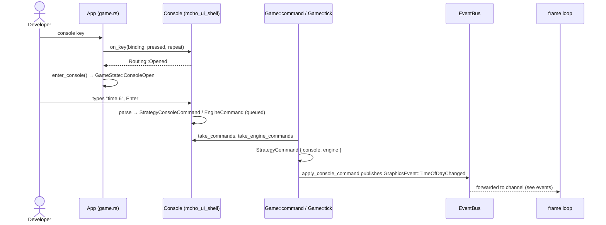

# Debug console

**Source:** `moho_ui_shell/src/console/` (`Console`, `Routing`, `CommandSpec`),
`flagstone_ui/src/console_commands.rs` (strategy commands), `flagstone/src/app/console.rs`
(applying them), `flagstone/src/app/game.rs` (`route_console_input`, `Game::command`).

An egui overlay for developer commands. The console is the engine's `moho_ui_shell::Console`,
shared with Searchlight ([ADR-0017](../../_todo/adr/0017-ui-shell-and-debug-values-are-engine-seams.md));
strategy registers its own commands on it (`flagstone_ui::console_commands::register`) and owns
the game-side effects. `GameState::ConsoleOpen` decides who gets input
([input-and-state](input-and-state.md)); the console is open exactly while the game is in it.

## Flow

Parsing happens inside the console, by the `parse` fn of the matching `CommandSpec`; it returns
the reply text and a command, or an error reply, and publishes nothing. The console never
touches `App`. Each tick, `Game::command` drains the queued commands into `StrategyCommand`
(before the `Playing` check, since the console is open only outside `Playing`), and
`Game::tick` applies them in order: strategy commands, then engine commands.

## Input routing

`App::route_console_input` offers every key and mouse-button press to `Console::on_key` before
egui or the action map, only in `Playing` and `ConsoleOpen`. The result is a `Routing`:

| `Routing` | Meaning |
|---|---|
| `Opened` / `Closed` | The console key (or `Esc` when open) toggled it; `enter_console` / `exit_console` run the state transition; the event ends there |
| `Console` | The open console takes the input; only egui sees it |
| `Game` | Not the console's; normal routing continues |

The console key is the reserved `console` entry of `[bindings]` (default backtick,
[prefs format](../reference/prefs-format.md)); `flagstone_ui::actions::load_bindings` drops it
before the strategy action map reads the section.

## Command → event

`flagstone/src/app/console.rs` maps each command to an event; the handlers are the same drains
as for any other publisher.

| Command | Event published | Handled in |
|---|---|---|
| `Quit` (engine) | `UiEvent::ExitRequested` | `process_ui_events` (auto-saves, then exits) |
| `DebugView(m)` (engine) | `GraphicsEvent::DebugViewChanged` | `process_graphics_events` |
| `ShadowQuality(q)` (engine) | `DebugEvent::SetShadowQuality` | `process_debug_events` |
| `SsaoQuality(q)` (engine) | `DebugEvent::SetSsaoQuality` | `process_debug_events` |
| `PlaySoundAt` (engine) | `AudioEvent::PlaySoundAt` | audio system |
| `ToggleGodMode` | `DebugEvent::ToggleGodMode { enabled: true }` | `process_debug_events` (logs only; not implemented) |
| `ToggleNoclip` | `DebugEvent::ToggleCollision { enabled: <current noclip> }` | sets `physics.noclip` to the opposite |
| `SetSunDirection { yaw_deg, pitch_deg }` | `GraphicsEvent::SunDirectionChanged` (radians) | `process_graphics_events` |
| `SetTimeOfDay(h)` | `GraphicsEvent::TimeOfDayChanged` | `process_graphics_events` |
| `ShowMarker { id, min, max, style }` | `DebugEvent::ShowMarker` | `process_debug_events` (`Scene::markers_mut().upsert`, fixed amber colour) |
| `ClearMarkers(id)` | `DebugEvent::ClearMarkers { id }` | `process_debug_events` (`remove`, or `clear` for `None`) |
| `SetViewHeight(h)` | `DebugEvent::SetViewHeight` | `process_debug_events` |
| `Spawn { kind, args }` | `DebugEvent::SpawnEntity { position: None }` | raycasts from the camera for a position |

Engine commands strategy does not handle are logged and dropped.

Command syntax: [console commands](../reference/console-commands.md). To add one:
[guide](../guides/adding-console-commands.md).

## Caveats

- God mode has no implementation behind the event.
