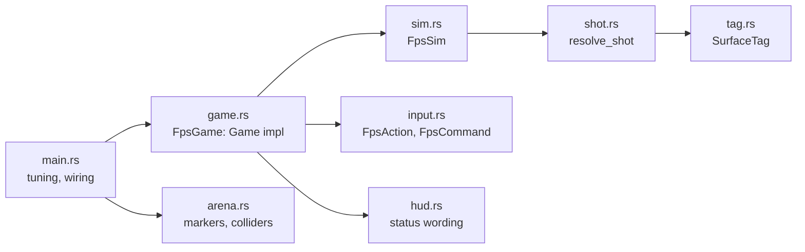

# FPS prototype

**Source:** `moho_fps/src/`, `moho_fps/assets/`.
**Decisions:** [ADR-0015](../../_todo/adr/0015-fps-rules-are-a-platform-free-crate.md).

`moho_fps` is the FPS line's engine adapter: a library and the `moho_fps` binary. Rules
(`Rifle`, `Magazine`, `Body`, `BodyProfile`) come from `moho_fps_rules`; windowing, loop,
physics, level loading, input, audio and rendering come from engine crates. It depends on no
strategy crate ([overview](overview.md#lines-and-rules)).

## Layers

| Module | Role |
|---|---|
| `arena` | Loads `assets/arena.glb` through `moho_level`; `ArenaMarkers` sorts named markers by kind; `physics_world` turns level meshes into world colliders |
| `input` | `FpsAction` set and default bindings; `FpsCommand::from_frame` builds the per-tick command from an `ActionFrame` |
| `tag` | `SurfaceTag` (`World` or `Part { target, part }`) and its lossless round trip through the engine's opaque `moho_physics::HitTag` |
| `shot` | `resolve_shot`: first tagged surface along a `ShotRay` in the `PhysicsWorld` |
| `sim` | `FpsSim`: player character, rifle, spare magazines and dummies; emits `Feedback` |
| `hud` | Text for rifle state and hits |
| `game` | `FpsGame`, the `moho_app::Game` implementation: samples input, ticks the sim, turns `Feedback` into sound, title status line, hit flash and crosshair |

`FpsSim` holds no renderer, audio or UI handle, so it runs under `moho_app::HeadlessLoop`.
`Feedback` is the only output: `FpsSim::tick` queues it, the game drains it
(`drain_feedback`) and reacts. `TICK_HZ` is 60. Tuning values (speeds, damage, cooldown,
magazine size, body profile) live in `main.rs` as a `SimConfig`.

## Tick

`FpsSim::tick(command, dt)` moves the player character, steps the physics world, then applies
weapon actions. The rifle is in one state at a time (ready, cooling down after a shot,
reloading); cooldown and reload are tick counts.

## Shot path

Player shots (and later enemy shots) go through one route:

1. `ShotRay` from the eye with range and the shooter's `CharacterHandle` as `ignore`.
2. `PhysicsWorld::cast_ray` returns the first collider hit and its `HitTag`.
3. `SurfaceTag::try_from` decodes the tag; an unknown tag is logged and counts as a miss.
4. A `Part` strike applies damage through `Body` in `moho_fps_rules`.

Tag encoding: `0` is `World`; any other value is `1 + ((target << 3) | part_index)`, with
`part_index` the position in `PARTS` (`tag.rs`). Dummies carry six hit volumes
(`dummy_hit_volumes`), one per `BodyPart`, tagged with the dummy's target number.

## Arena contract

Markers are node names in the glTF file. `player_spawn` is required and unique; at least one
`dummy_NN` is required; `enemy_spawn_NN`, `waypoint_NN` and `cover_NN` are optional. Each
`cover_NN` carries a `shielded_from` extra (`+x`, `-x`, `+z`, `-z`). Spawns are floor points;
`FpsSim::new` lifts capsule centres by `STAND_HEIGHT`. Errors surface as `ArenaError`.

`assets/arena.glb` and `assets/rifle_shot.wav` are generated by
`assets/tools/make_arena.py`; see [`assets/README.md`](../../moho_fps/assets/README.md) for
regeneration and licence. A replacement arena must keep the marker names.
