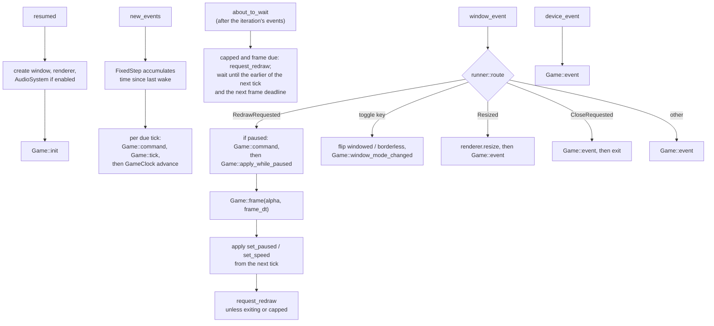

# Frame loop

**Source:** `moho_app/src/` (`runner.rs`, `lib.rs`, `window_keys.rs`, `loop_requests.rs`, `headless.rs`, `fixed_step.rs`, `clock.rs`), `flagstone/src/app/game.rs`
(`impl moho_app::Game for App`), `flagstone/src/app/event_loop/`.
**Related:** [ADR-0009](../../_todo/adr/0009-simulation-time-is-one-fixed-tick.md) (fixed tick).

`moho_app::run` owns the window, the winit `ApplicationHandler` (`runner.rs`) and the
renderer and audio handles. A game implements the `Game` trait; the binary's `App`
implements it in `flagstone/src/app/game.rs`. Simulation runs in fixed ticks from `new_events`,
window and device input go to `Game::event`, drawing is `Game::frame` on `RedrawRequested`.

## 1 Callbacks



A game stops the loop with `request_exit` on its `FrameContext` or `EventContext`.
Init failures (window, renderer) end `run` with an `AppError`; audio failure only logs.
`FrameContext::renderer` and `audio` are `None` under `HeadlessLoop`, which drives the
same `command`/`tick`/`frame` without a window (`init` and `event` never run).
Every frame requests the next redraw, so frames run at the presentation rate and look turns the view on each one; `FrameContext::frame_dt` is the time since the previous frame, capped at `tick_length` times `max_catch_up_ticks`. Time beyond `max_catch_up_ticks` is dropped ([overview](overview.md#4-fixed-step-loop-moho_app)).
A game caps the frame rate with `FrameContext::set_frame_cap(Option<NonZeroU32>)` (frames per second); a game that never calls it is uncapped. The runner holds a `FramePacer` (`moho_app/src/pacing.rs`) that times the next frame from when the last one was actually drawn. Uncapped frames request the next redraw themselves. When capped, a frame does not: `about_to_wait` requests a redraw once the pacer is due, and sets the wait to `WaitUntil(min(next tick, next frame due))`. It runs after the iteration's events, so it sees the frame just drawn; an overdue deadline is not waited on (the loop waits for the next tick until the requested redraw arrives). Any `RedrawRequested`, including OS-originated ones (expose, resize), is a frame and restarts the pacer's interval. Ticks keep their own schedule, so a low cap never slows the simulation. `App` hands the cap to the loop from its prefs: none while vsync is on (the display paces frames) or `fps_max` is 0, else `fps_max`.
Window mode: before any game callback, `window_event` feeds key and focus events to `ToggleKeys` (`window_keys.rs`) when `AppConfig::toggle_keys` is `Some`. Alt+Enter and the configured `Input`s flip between `WindowMode::Windowed` and `WindowMode::Borderless` (winit borderless fullscreen); the runner consumes the press, its repeats and its release, so the game never sees them, then calls `Game::window_mode_changed`. Losing focus clears held-Alt state. With `None`, no event is observed and nothing flips. Searchlight sets the `fullscreen` binding, default F11 ([searchlight](../searchlight/architecture.md)); flagstone sets `None`.

The window opens in `AppConfig::window_mode` (borderless is set on the window attributes, so it never shows windowed first), and that value seeds the runner's current mode. A flip reads the window's actual fullscreen state first, since the OS can leave fullscreen on its own. Every `EventContext` and `FrameContext` reports the current mode (`window_mode()`); a game switches it with `set_window_mode()`, which the runner applies after the callback returns (`LoopRequests` in `loop_requests.rs`, alongside pause and speed). A requested switch does not call `Game::window_mode_changed`. `FrameContext::set_window_size(width, height)` asks for an inner size in physical pixels (last request wins); the runner applies it after the callback only when the window ends up windowed (after any mode request in the same callback), then resizes the renderer at once if the platform applied the size synchronously, since that may raise no `Resized` event.
A game pauses or changes `SimSpeed` through `set_paused` / `set_speed` on its event or frame context; the loop applies the request after the callback returns, from the next tick. While paused the loop runs no tick and still renders every frame ([ADR-0018](../../_todo/adr/0018-paused-commands-apply-at-the-tick-boundary.md)).

## 2 `Game::tick` order (`App`)

`tick` receives the `StrategyCommand` sampled by `command()` (movement, jump and look from the
tick's `ActionFrame`; default outside `GameState::Playing`). Steps, in order:

```mermaid
sequenceDiagram
    participant T as App::tick
    participant Bus as EventBus
    participant Sim as Simulation + Physics
    participant LS as LightSystem
    T->>T: clock time scale = 1 if Playing, else 0<br/>autosave schedule ticks (Playing only)
    T->>Bus: SystemEvent::FrameStart
    T->>Sim: apply command, update_game_state (Playing only)
    Note over Sim: KCC: command → physics character (look + move) → camera;<br/>free-fly: controller input → camera;<br/>step rigid bodies
    T->>LS: update_chunk_streaming
    Note over LS: evict / load chunks, light arrived chunks,<br/>publish WorldEvent::ChunkMeshDirty
    T->>LS: update_light_system (budgeted jobs, then sky refresh)
    T->>Bus: SystemEvent::FrameEnd
    T->>T: drain event channels
    T->>T: check_generation_cancel, poll_generation
```

Scene load and the console `time` command reset the clock (`reset_to`) while the events
drain. The loop advances the clock after `tick` returns, so a reset made in a Playing tick
gets that tick's advance on top.

All gameplay steps early-return unless `GameState::Playing`. `dt` is the fixed tick length.

Mining publishes its block event while `process_input_events` drains, after
`process_world_events`, so the light system queues the edit on the next tick and lights it in
the tick after (two ticks, about 33 ms at 60 Hz).

## 3 Event drain

The tick drains one channel per event family, in this order:

| # | Drain | Effect |
|---|---|---|
| 1 | `process_ui_events` | load/new world, exit and main-menu requests (their auto-save runs in `frame`), resume, menus |
| 2 | `process_graphics_events` | time of day, debug view |
| 3 | `process_world_events` | every world event → `LightSystem::handle_event`; each `ChunkMeshDirty` chunk → remesh once (draw + collider); `BlockPlaced`, `BlockRemoved` and `BlocksBatchModified` mark the autosave schedule edited |
| 4 | `process_input_events` | wheel zoom, mine action |
| 5 | `process_debug_events` | spawn, noclip; point lights and shadow/SSAO quality are queued as `RenderRequest`s |

Audio events are drained in `Game::frame` and forwarded to `AudioSystem`, since the runner
owns it. `AudioEvent::PlaySoundAt` carries a world position: `AudioSystem` attenuates
sound-effect and voice sources by distance from its `Listener` (full volume within 2 m,
inverse distance beyond, not played past 100 m; `moho_audio/src/spatial.rs`). They are also
constant-power panned by direction relative to the listener's facing (centred sounds play
3 dB quieter per ear; stereo files are folded to mono). A rear cue scales volume by 1.0 at
or in front of the listener's side, falling linearly to half straight behind. Why channels instead of handling inside bus handlers: [events](events.md#the-channel-hand-off).

## 4 Frame

The renderer is reachable only through the contexts, so ticks queue renderer changes
(`RenderRequest`: point lights, shadow and SSAO quality) and `Game::frame` applies them.
`App::frame`, in order:

1. `poll_gamepads`: apply pad events while playing with focus, otherwise discard them
   and release pad actions;
2. apply the HUD's view-height pick (`view_level::update`, [cut](rendering.md#3-cut-face-caps)), then queued `RenderRequest`s; when an audio system exists, apply queued
   `AudioSettings` (they stay queued without one) and set the listener from the frame
   camera (`Listener::from_view`); then drain audio events;
3. if the UI asked to quit: auto-save, `request_exit`, stop;
4. if the UI asked for the main menu (Exit to main menu): auto-save, then `show_menu`, and go on;
5. if the autosave schedule is due: auto-save ([periodic autosave](../reference/save-format.md#autosave));
6. `update_hud_data`, `update_cut_caps` (rebuild [cut-face caps](rendering.md#3-cut-face-caps)), then `update_lighting` (sun, moon, ambient) and `scene.render(...)`
   with actors, the sphere and cube mesh handles and the frame camera (below).

A `FrameError` skips the frame with a `warn`. Pass order inside the renderer:
[rendering](rendering.md#5-pass-order).

### 4.1 Frame camera

`App::render_camera(alpha)` picks the camera per frame. While `App::is_kcc_walking`
(Playing, first person, character controller active and not noclip) the eye (`CharacterState::eye_position`, so it follows the body's eye offset) is blended
between the player's last two tick states by `alpha` (0 = previous tick, 1 = current), and the view's `up` is rolled about `forward` by the state's `roll` blended the same way, via
`moho_physics::first_person_view` (`moho_physics/src/camera.rs`); look comes from the
current tick turned by the pending look: what frames sampled (`ActionMap::sample_frame`) and no tick has consumed yet, pitch clamped with the same f32 operations as `moho_physics::step`, so the next tick lands on exactly the drawn angles. `PhysicsController` keeps the pre-tick state (`previous`) for this and
resets it on spawn and `reset`. A queued teleport or look is applied by the next tick, so until then `player_states()` withholds the stale states and the tick camera, already at the new place, is drawn; that tick then records `previous` as its own result, so the eye does not blend across the jump. In every other first-person case (free-cam, or outside play) the tick camera is drawn
turned by the pending look (`PlayerController::turned`), with no eye blend; in isometric the tick camera is drawn
unchanged. Frames sample look only while Playing, focused and in first person; otherwise the pending look stays frozen and still drawn.

The isometric (strategy) camera is a free pan over the terrain, separate from the pawn.
Pan input is the move axes plus an edge-pan term (`flagstone_game::controller::edge_pan_axes`,
band `EDGE_PAN_MARGIN_PX`) added only while Playing, focused and isometric, then clamped to
-1..1; a pointer that left the window pans nothing. `PlayerController::apply_input` takes a
`ground_height(x, z)` lookup (via `SimulationController::apply_input`; the non-KCC branch of
`FrameProcessor` supplies it from the `LightSystem` grid): the focus height eases toward the
ground under the focus, then the focus is raised so the eye stays `CAMERA_CLEARANCE` above
the surface under the eye. A column that is not loaded skips its rule. Pan speed scales with
the zoom height (`rts_height`).
