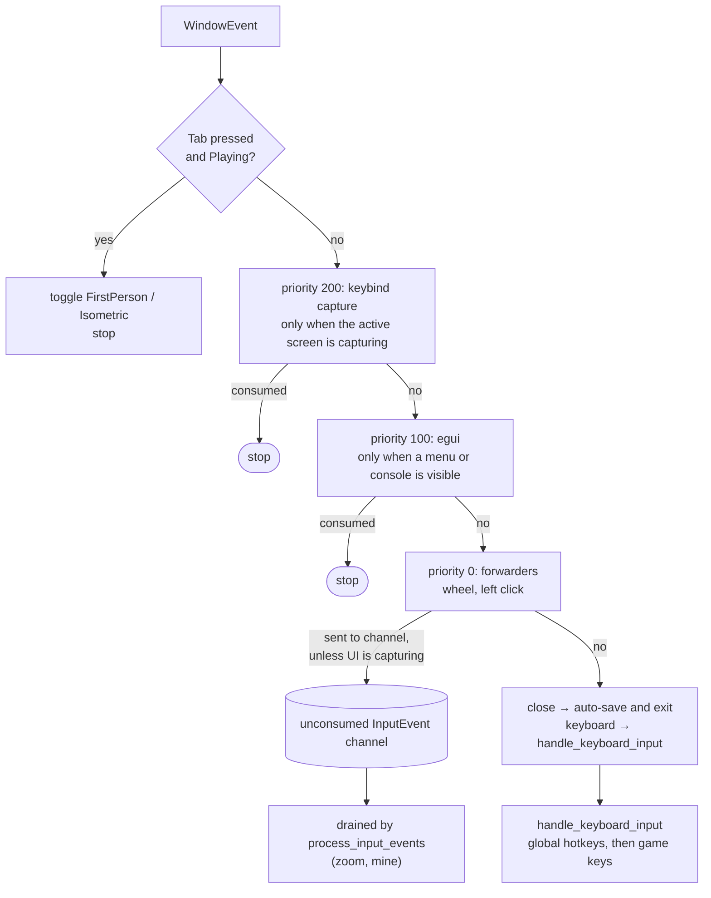
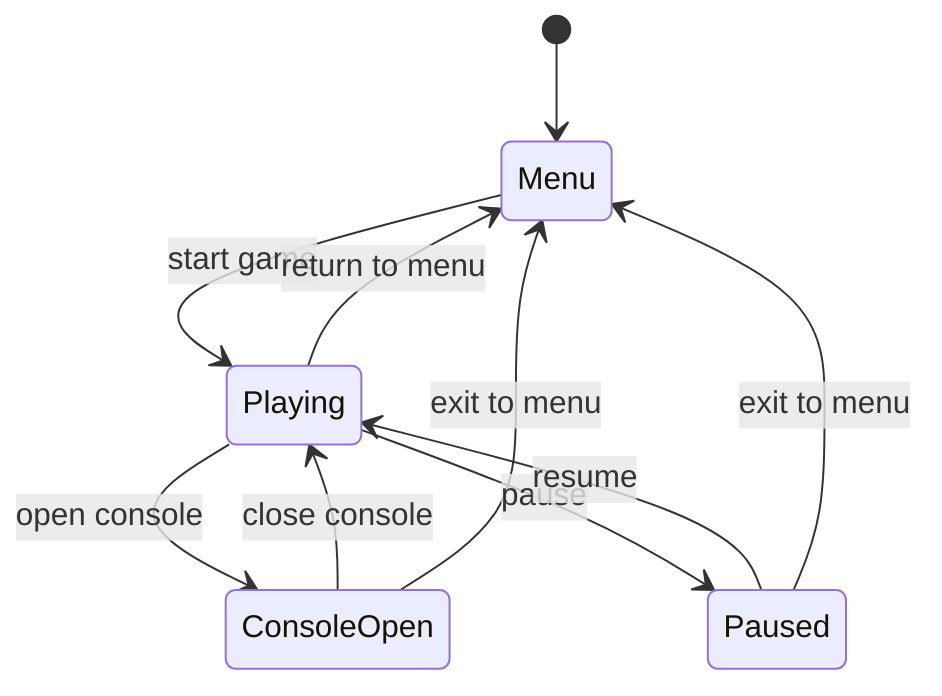

# Input and state

**Source:** `flagstone/src/input_dispatcher.rs`, `moho_input/src/`, `flagstone_ui/src/actions.rs`, `flagstone/src/app/renderer_setup.rs` (registrations),
`moho_core/src/pointer.rs`, `flagstone/src/app/game.rs` (`Game::event`, `poll_gamepads`), `flagstone/src/main.rs` (`handle_keyboard_input`), `flagstone_ui/src/app_state/game_state.rs`,
`flagstone_ui/src/app_state/state_coordinator.rs`, `flagstone_ui/src/screens/pause.rs`, `moho_ui_shell/src/console/` (console key routing).

## 1 Input routing

Every `WindowEvent` the runner forwards reaches `Game::event` (`App::handle_window_event`) and goes through this order. The first stage that
consumes the event ends the path.

`InputDispatcher` is a sorted `Vec<(priority, handler)>`. **Higher number runs first.**
This is the opposite of `EventBus::subscribe_with_priority` (lower first); the two are
independent.

Two properties that bite:

- Each input kind gets its own `register` call (wheel and mine-click are separate
  handlers), so a new input type is a new registration, not a new branch.
- A forwarder drops the event rather than blocking if it can't take the UI adapter lock.
- During gameplay, with a free cursor, egui sees pointer motion and mouse buttons (`EguiAdapter::handle_gameplay_event`, `feeds_egui`), so it knows what lies under the pointer and widgets such as the view-height slider can be dragged. While the cursor is free (strategy view), a mouse press over a panel is consumed and never reaches the game; in first person egui gets only mouse releases, so a press on a widget before the cursor is grabbed does not leave it held. The mine-click forwarder leaves the press unconsumed, so the action map sees it too.

Global hotkeys in `handle_keyboard_input`, checked before game keys:

| Key | Effect |
|---|---|
| `` ` `` (the `console` binding) | Playing → console; ConsoleOpen → Playing. Routed by `App::route_console_input` through `Console::on_key` ahead of the dispatcher, see [console](console.md#input-routing) |
| `Esc` | ConsoleOpen → Playing (taken by `Console::on_key` before this handler, as the console key is); Playing → Paused; Paused → Playing while the pause window is the active screen (inert on Settings). Taken before the dispatcher when it pauses or resumes, so a focused egui button cannot swallow it; key repeats are ignored |
| `F3` | Toggle debug HUD |
| `F4` | Toggle chunk-boundary minimap |
| `Tab` | Toggle camera mode (handled before the dispatcher) |

Gameplay input is action-keyed. `moho_input` holds the platform-free `Key` and
`MouseButton` (`Key::from_winit` maps `PhysicalKey`), the `Action` trait (stable id plus
default bindings), `ActionBindings<A>`, and `ActionMap<A>`
(`moho_input/src/action_map.rs`). Each game declares its own action enum
(`StrategyAction` in `flagstone_ui/src/actions.rs`); the binary owns one `ActionMap` in
`InputState` (`flagstone/src/app/input_state.rs`).

`handle_window_event` and `handle_device_event` feed key, mouse-button and raw
mouse-motion events into the map. Gamepads feed it too: `Gamepads::poll`
(`moho_input/src/gamepad.rs`, the only module that names `gilrs`) drains backend events
into `pad_button` / `pad_axis` once per frame from `App::poll_gamepads`
(`InputState::gamepads`, `None` when the backend fails to start). Outside `Playing`, or
while the window lacks focus (`InputState::focused`), the events are discarded unapplied
and `pad_disconnected` releases pad bindings. Every menu and console transition (`App::apply_transition`,
`flagstone/src/main.rs`) also calls `ActionMap::release_all`, so nothing stays held across a menu or the
console and no press made there lands on resume; a key still down on resume acts only after it
is pressed again. Once per tick `App::command` (`flagstone/src/app/game.rs`) calls `end_tick`,
which returns an `ActionFrame` and resets the per-tick state:

- `held`: down at the end of the tick; `pressed` / `released`: edges at any point in the
  tick, so a tap shorter than a tick is not lost.
- `look`: the pending look that rendered frames sampled with `ActionMap::sample_frame(frame_dt)` since the last tick (read with `pending_look`); a tick consumes exactly what the last frame showed. The right stick adds `PAD_LOOK_PER_SECOND` times its deflection per second of frame time (after a
  small dead zone), on top of the mouse input below. The mouse part is the motion accumulated since the previous frame, its vertical part negated first when `LookSettings::invert_y` is on (the stick share is never inverted), smoothed when `LookSettings::smoothing`
  is on (a two-sample mean of raw counts, `MouseSmoothing` in `moho_input/src/filter.rs`, which loses no motion),
  then scaled by `LookSettings::look_per_count` (radians per count, from the Source-scale sensitivity pref via `source_look_per_count`) plus `LookSettings::acceleration` times the mouse speed (the smoothed counts' length per millisecond of frame time; 0 when acceleration is off or the frame time is zero). `PAD_LOOK_PER_SECOND` is a half turn per second at the default sensitivity. `ActionMap::set_look` applies new settings. Motion is unnegated; `App::command` inverts it for
  yaw and pitch.

A `Binding` is an `Input` (key, mouse button or pad input) plus a `Trigger`: `Press` or `Hold`. A `Hold` binding fires once its input has been down `Action::HOLD_TICKS` ticks (default `DEFAULT_HOLD_TICKS`, 18; one value per game, at least 1) and the action then stays held until release. An input that any action binds with `Hold` is split: its `Press` bindings no longer fire on press but as a tap (pressed and released in the same tick) when the input is released before the threshold; a release at or after maturing is not a tap. An input with no `Hold` binding fires `Press` bindings on press as usual. Searchlight uses this on `R`: tap reloads, hold checks the magazine.

A `Binding` also carries `Modifiers`, a set of Ctrl, Shift and Alt that must be down with its input (a chord such as `Ctrl+R` or `Shift+Mouse Left`; pad inputs take none). When a key or mouse button goes down, the map resolves which modifier set it acts under: of the sets bound on that input and currently held, the one with the most modifiers wins, ties going Ctrl, then Shift, then Alt; no match means no modifiers, so an unbound chord falls through to the plain action. The set is fixed at the press and not re-read until release, so releasing a modifier first does not refire the plain binding and pressing one late does not turn the press into a chord. A binding is active only while the input's resolved set equals the binding's. A modifier key keeps its own bindings while it carries a chord. Hold splitting applies per (input, modifier set), so `Hold Ctrl+R` leaves plain `R` presses unsplit.

A stick direction binding is down while its axis is at or past `STICK_DIRECTION_THRESHOLD`.
An action is held when any of its bindings is active under the rules above. A frame holds at most 64 actions.

An action opts into a player-chosen mode with `Action::toggleable` (default false; `StrategyAction::Sprint` is the only one). `ActionBindings` stores an `ActionMode` per toggleable action (`Hold`, the default, or `Toggle`; `moho_input/src/bindings.rs`). In `Toggle` mode the map keeps a latch per action: a rising edge or a tap of the resolved mask flips it, and the reported held bit and the `pressed` / `released` edges follow the latch. `release_all` clears the latches. Non-toggleable actions always read as `Hold`. The Settings controls tab shows a hold/toggle checkbox beside a toggleable action's binding.

The map also tracks the pointer in physical pixels: `ActionFrame::pointer` is its position at the end of the tick (`None` outside the window), and `press_pointer` is its position at the last mouse press in the tick. `StrategyAction::Select` (left mouse by default) is the strategy view's primary pointer action.

Bindings persist in the `[bindings]` section of [prefs](../reference/prefs-format.md), and modes in `[action_modes]`.

## 2 Pointer picking

In the isometric view, a tick with `Select` pressed turns `press_pointer` into a world `Ray` with `moho_core::pointer::screen_ray` (view and projection of the frame the player saw, window size as viewport) and carries it in the command as `select`. The ray, not the pixel, is the command, so it replays without a window. The apply step casts it with `flagstone_game::raycast::raycast_surface` over `POINTER_RAY_RANGE` and stores the result in `App::pointer_hit`; a miss clears it. First-person never selects.

## 3 GameState

`flagstone_ui::GameState` decides input routing, rendering, cursor and whether the
simulation runs. `can_transition_to` is the legality table; `StateTransitionCoordinator`
returns the UI visibility and the menu to show for a legal transition. The cursor
follows `cursor_grabbed(state, camera_mode)`, not the coordinator.

Same-state transitions are allowed (no-op). Everything else is rejected, including
`Menu → ConsoleOpen` and `ConsoleOpen ↔ Paused`.

| State | Input goes to | Draws | Cursor | Simulation |
|---|---|---|---|---|
| `Menu` | menu | menu screens | free | stopped |
| `Playing` | game | world | grabbed in first person, free in the isometric view | running |
| `ConsoleOpen` | console text | world (frozen) + console | free | paused |
| `Paused` | pause menu | world (frozen) + menu | free | paused |

`GameState::home_screen` names the screen a state shows on entry and that Back returns to: `start` for `Menu`, `pause` for `Paused`, none for `Playing` and `ConsoleOpen`. The pause window (`PauseMenu`, screen `pause`) offers Continue, Settings and Exit to main menu. Continue and Exit publish `UiEvent::ResumeRequested` and `UiEvent::MainMenuRequested` from `process_menu_action`; the binary resumes through `StateTransitionCoordinator::resume_game`, and on a main-menu request `App::frame` autosaves, then shows the main menu.

`flagstone/src/game_state.rs` re-exports `flagstone_ui::GameState`; the UI adapter takes the same type. Per-frame gameplay steps check `== Playing` ([frame-loop](frame-loop.md)).
