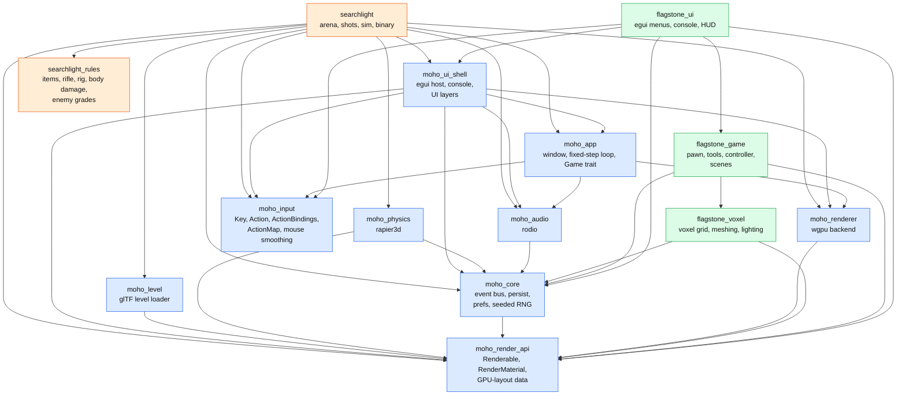
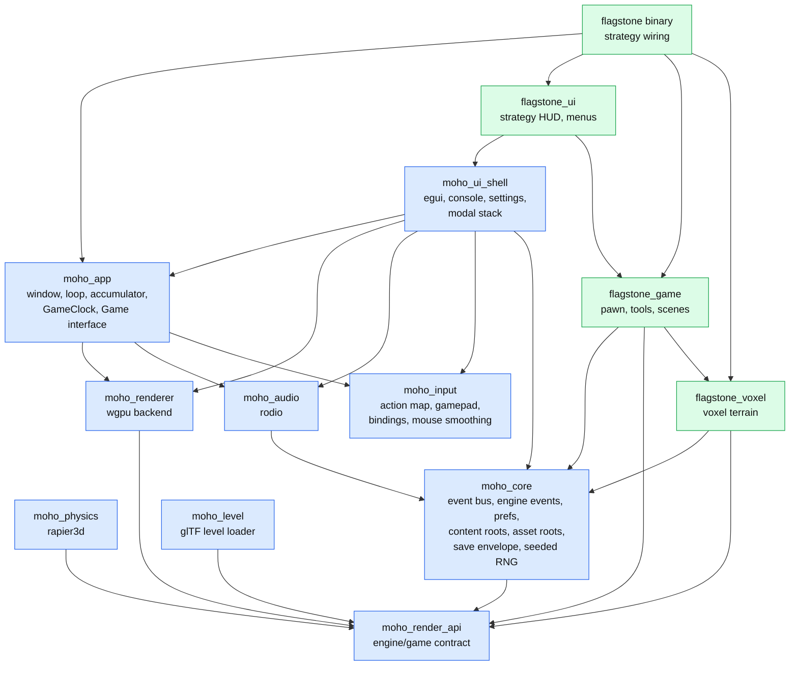
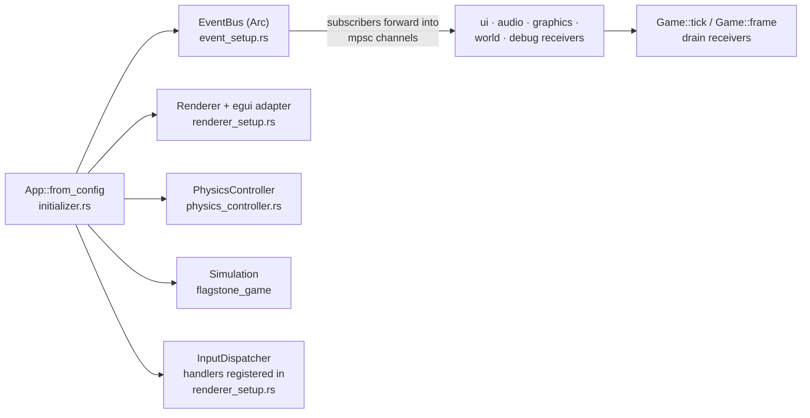

# Architecture overview

**Source:** crate `Cargo.toml`s, `moho_core/src/rng.rs`, `moho_core/src/sim_math.rs`, `scripts/sim-math.txt`, `scripts/layering.txt`, `moho_ui_shell/examples/frame_probe.rs`, `moho_app/src/`, `searchlight_rules/src/`, `searchlight/src/`, `flagstone/src/app/`, `flagstone/src/main.rs`.
**Decisions:** ADRs
[0001](../../_todo/adr/0001-render-api-boundary.md),
[0003](../../_todo/adr/0003-core-owns-event-types.md),
[0004](../../_todo/adr/0004-entity-storage-without-a-general-ecs.md),
[0005](../../_todo/adr/0005-crate-lines-and-dependency-direction.md),
[0010](../../_todo/adr/0010-world-geometry-is-a-mesh-contract.md),
[0012](../../_todo/adr/0012-engine-crate-map-for-m2.md),
[0017](../../_todo/adr/0017-ui-shell-and-debug-values-are-engine-seams.md),
[0022](../../_todo/adr/0022-character-changes-are-tick-input.md).

## 1 Crate graph

Arrows run from dependent to dependency; colour is the line from `scripts/layering.txt`.
The `flagstone` binary depends on every flagstone-line crate and the engine crates it wires, and is omitted from the edges.

Blue is the engine line, green is the flagstone line, orange is the searchlight line.
`searchlight_rules` holds plain serialisable item, weapon, body and enemy-grade rules (`ItemDef`, `Rifle`, `Magazine`, `Rig`, `Loadout`, `Kit`, `Body`, `Grade`)
with no engine dependency. `searchlight` is the only searchlight-line crate that reaches the engine: a library
plus the `searchlight` binary, described in [Searchlight](../searchlight/architecture.md). Every shot resolves
through one path (ray, surface tag, part, rule call) for player and enemy alike
([ADR-0015](../../_todo/adr/0015-fps-rules-are-a-platform-free-crate.md)).
`moho_ui_shell` is the engine's only egui-facing crate: the console every game opens and adds commands to, the egui host that draws it, and the screen text a game sets each frame (`UiShell::set_texts` with `ScreenText` and `Anchor`, `moho_ui_shell/src/text.rs`; each call replaces the list and refuses a size that is not finite and positive, painted under the console and cleared by the frame that paints it), and menu screens a game describes as data (`MenuScreen`, `MenuItem`, `MenuStack`, `moho_ui_shell/src/menu.rs`; the shell draws them, hovers and clicks them in logical points, and reports choices as `MenuEvent`s the game answers by pushing or popping). While a screen is open the shell dims the whole window and paints a panel under the rows and texts (`moho_ui_shell/src/backdrop.rs`), the same for every game, under the console. A column taller than the window scrolls: focus changes bring the focused row into view, and the mouse wheel scrolls by rows (`UiShell::on_window_event`) without moving the focus. `MenuStack::set_items` replaces the top screen's items in place, keeping its column and scroll; a capture goes on only while the same `Control` row has the focus, and ends without an event when that row is gone; the focus stays on the same row (the same index if the row there is the same one, else the nearest that is, by action for `Control` and `Button`, by action and slot for `Details`, by setting or key for settings rows). A `Control` row may carry a chevron (`Chevron`, drawn `>` or `v`) and a hold/toggle checkbox (`mode`): the chevron reports `MenuEvent::DetailsToggled` and the game answers with `set_items`, putting that action's `MenuItem::Details` rows (one per slot, a kind picker and a modifier picker) under it, so one open at a time is the game's rule; a closed chevron shows only plain presses (`Binding::is_plain`) and marks the label ` +` when a slot is hidden. Enter or a click on a picker steps it and reports `MenuEvent::Picked` with the slot's new kind and modifiers, and the checkbox reports `MenuEvent::ModeChosen`; the game keeps the result. A per-action reset is an ordinary `Button` among the detail rows. A screen with a checkbox widens its `Control` and `Details` rows from 640 to 768 points. `MenuItem::Control` is a rebindable-action row with two binding slots (`Slot`); Enter or a click on a slot starts a capture, the next unprotected press is reported as `MenuEvent::Captured`, and Backspace or a right-click on the focused slot clears it as `MenuEvent::Cleared`; the game applies both; opening the console cancels a capture (`MenuStack::cancel_capture`). An item lists screen is the other kind of stack entry (`MenuStack::push_lists`, `ItemLists`, `ItemList`, `ListRow`, `ListId`; `moho_ui_shell/src/lists.rs`): any number of titled, scrollable lists side by side, each row a label, an optional count and tooltip, and the game's item value. Up and Down move the focus in a list, Left and Right switch lists (both wrap), Enter or a click picks a row up and then places it in a list, and Escape or a right click lets go (Escape with nothing held chooses `ItemLists::back`). Placing reports `MenuEvent::MoveRequested`; the shell moves nothing, and the game applies or refuses the move and answers with `MenuStack::set_lists`, which keeps each list's focus and scroll, and a held row, by `ListId` and item. A row may offer actions (`ListRow::actions`, each a `RowAction` with a label, the game's action value and an `ActionTarget`): Space, or a right click on a row, opens them beside the list, Up and Down move among them, Enter picks one and Escape, Space or a right click closes them. An `Itself` action is reported at once; an `AnotherRow` action holds the row and asks for a second one, and either way the shell reports `MenuEvent::ActionPicked` (`target` is a `RowRef` of the second row, `Some` exactly when one was asked for), moves nothing, and the game answers with `set_lists`. `MenuStack::set_items` replaces the top screen's items in place, keeping its focus, slot, capture and scroll. `MenuItem::Control` is a rebindable-action row with two binding slots (`Slot`); Enter or a click on a slot starts a capture, the next unprotected press is reported as `MenuEvent::Captured`, and Backspace or a right-click on the focused slot clears it as `MenuEvent::Cleared`; the game applies both; opening the console cancels a capture (`MenuStack::cancel_capture`). A screen with `MenuScreen::settings` set carries the engine's twelve player settings as ready-made rows (`MenuItem::Setting(EngineSetting)`, `MenuItem::Apply`; values in `EngineSettings`, read from and written to `Prefs`, `moho_ui_shell/src/settings.rs`): sliders (also dragged with the mouse), toggles and choices edit a staged copy that Back discards, and Apply reports it as `MenuEvent::SettingsApplied`. A game adds its own slider rows to such a screen with `MenuItem::GameSlider(GameSlider)` (key, label, range, step, unit, starting value; `moho_ui_shell/src/settings.rs`); they are staged with the engine rows, and Apply also reports every row's value, by key, as `MenuEvent::GameSettingsApplied`, which the game stores (for example in `Prefs::set_game_value`, `[game]`). `apply_engine_settings` (`moho_ui_shell/src/apply.rs`) hands the renderer its shadow and SSAO qualities (the effects quality lives on the game's `Scene`, so the game hands it to `Effects::set_quality` itself), the audio system its master, effect, music and UI volumes, and the loop the window mode and size; the game saves the prefs and applies the look and mouse values itself ([ADR-0026](../../_todo/adr/0026-menus-and-settings-controls-are-ui-shell-seams.md), [ADR-0017](../../_todo/adr/0017-ui-shell-and-debug-values-are-engine-seams.md)). `UiShell::paint(&egui::Context)` draws the queued images, text, menu and console into a context the caller owns, so a harness with its own context (`egui_kittest`) renders the window's menu, text and console (not queued images, whose textures live in the shell's context, and the queue is only cleared by `ui_frame`); `moho_ui_shell/tests/accessibility_probe.rs` finds shell controls by role and label through it, and `moho_ui_shell/examples/frame_probe.rs` renders a fixed frame offscreen on whatever adapter is present and compares two runs pixel for pixel (`frame_probe render` and `compare`; the informational `Frame probe` workflow runs it twice on a software Vulkan driver and is not a gate).
`moho_app` owns the window and winit event loop; the binary implements its `Game` trait and hands it
to `moho_app::run` ([frame loop](frame-loop.md)).

## 2 Lines and rules

Each crate belongs to exactly one line ([ADR-0005](../../_todo/adr/0005-crate-lines-and-dependency-direction.md)).
`just check` enforces these over normal and build edges:

| Rule | Reason |
|---|---|
| Engine crates never depend on a game-line crate (dev-dependencies allowed) | The engine ships to both games and, after the split, from its own repo |
| A game line never depends on another game line | Flagstone and Searchlight must separate cleanly |
| Domain crates (`moho_core`, `flagstone_voxel`, `flagstone_game`, `moho_level`, `searchlight_rules`) never reach `winit`, `wgpu` or `egui` | Domain logic runs headless |
| Only `moho_renderer` (the `gpu` row of `scripts/layering.txt`) reaches `wgpu`, `egui-wgpu` or `naga` without going through another workspace member, dev-dependencies included. Crates in the `gpu-dev` row (`moho_ui_shell`) may reach them through dev-dependencies only, never over normal or build edges ([ADR-0036](../../_todo/adr/0036-crates-may-test-against-the-gpu-stack.md)) | GPU code stays behind the renderer boundary; the shell's offscreen test harness needs a wgpu adapter |

Voxels live in the flagstone-line `flagstone_voxel` ([ADR-0010](../../_todo/adr/0010-world-geometry-is-a-mesh-contract.md));
the engine sees world geometry only as meshes.

## 3 Engine crate map (ENG-M2)

Where the ENG-M1–ENG-M2 engine work lands, from [ADR-0012](../../_todo/adr/0012-engine-crate-map-for-m2.md)
(Accepted). Capabilities land as modules of an existing crate first; a new crate needs a
deployable, reuse or compile-time boundary. Every crate in the graph exists.
Edges are the intended direction, not a list each crate must have; section 1 has the actual ones.

Changes from today:

- Scene import (ENG-F14) is its own crate, `moho_level`: a headless server needs level
  collision without linking `wgpu` or `winit`.
- Navigation (`moho_level::NavMesh`: walkable polygons built from world meshes for an
  `AgentProfile`, and corner paths between points) is a module of `moho_level`
  ([ADR-0019](../../_todo/adr/0019-navigation-is-an-engine-seam.md)). The character
  controller and camera (ENG-F21) are modules of an engine crate unless their specs name a
  boundary.

The searchlight line sits beside the flagstone line and depends only on engine crates.

### 3.1 Engine seams

The public APIs the [ENG-F5](https://github.com/WrackedFella/moho/issues/232)
gate holds fixed: game plug-in interface, world-geometry contract, action map, physics
queries, spatial audio, content roots, save envelope, scene import ([ADR-0012](../../_todo/adr/0012-engine-crate-map-for-m2.md), seams 1 to 8),
the UI shell and debug values ([ADR-0017](../../_todo/adr/0017-ui-shell-and-debug-values-are-engine-seams.md), seams 9 and 10; menus and settings controls join them in [ADR-0026](../../_todo/adr/0026-menus-and-settings-controls-are-ui-shell-seams.md)), and navigation
([ADR-0019](../../_todo/adr/0019-navigation-is-an-engine-seam.md), seam 11), and asset roots and the install locator (`moho_core::install::Install::locate`)
([ADR-0042](../../_todo/adr/0042-shipped-assets-resolve-per-file-through-named-folders.md), rules 1 to 5 and 6). Adding or changing
one is an ADR-level change.

## 4 Fixed-step loop (`moho_app`)

Window-free scheduling for any game line ([ADR-0009](../../_todo/adr/0009-simulation-time-is-one-fixed-tick.md)).

| Item | Role |
|---|---|
| `Game` trait (`lib.rs`) | `command()` sampled once per tick, `tick()` applies it, `frame()` presents with an interpolation `alpha`; optional `init()` (window and renderer exist), `event()` (winit window/device events), `window_mode_changed()` (after the runner flipped windowed/borderless) and `apply_while_paused()` (a command applied at the tick boundary while paused) |
| `run`, `AppConfig` (`runner.rs`) | Creates the window, renderer and optional `AudioSystem`, drives the `Game` from the winit loop; `toggle_keys` selects the inputs that flip windowed/borderless and `window_mode` the mode the window opens in ([frame loop](frame-loop.md#1-callbacks)); `AppError` on startup failure |
| `InitContext` / `EventContext` / `FrameContext` (`lib.rs`) | What a game may touch: window, renderer, audio, `request_exit`, `set_paused` / `set_speed` (`EventContext`, `FrameContext`; recorded, applied by the loop from the next tick) and `frame_dt` (`FrameContext`: time since the previous frame, capped at `max_catch_up_ticks` ticks) a read-only `clock()` (`EventContext`, `FrameContext`), and `window_mode()` / `set_window_mode()` (`EventContext`, `FrameContext`; a request is applied after the callback without `window_mode_changed`) and `set_window_size()` / `requested_window_size()` (`FrameContext`; see [frame loop](frame-loop.md#1-callbacks)). Renderer and audio are `Option` (absent headless) |
| `GameClock` (`clock.rs`) | Time of day, day/night lengths, time scale and sun/moon directions. Seeded from `LoopConfig::clock`, owned by the loop (`run` and `HeadlessLoop`); `TickContext::clock` is `&mut` for the tick, and the loop advances it by one tick length times its time scale after `Game::tick` returns. `record(next_tick)` / `from_record` save and restore it as a `LoopRecord` ([frame loop 4.2](frame-loop.md)) |
| `LoopConfig` / `FixedStep` (`fixed_step.rs`) | Integer accumulator (`nanoseconds * tick_hz`), so no drift; returns whole ticks due per frame. `SimSpeed` (`X1`/`X2`/`X3`) multiplies ticks per second of real time, never the tick length |
| `HeadlessLoop` (`headless.rs`) | Drives a `Game` without a window: `advance(game, frame_dt)` runs due ticks then one frame; `step(game, n)` runs ticks only (also while paused); `set_paused`, `set_speed`, `paused()`, `next_tick()`; `record()` / `restore(record)` save and resume the tick index and clock |

Invariants: ticks per frame are capped by `max_catch_up_ticks` (default 5) and time beyond the cap is
dropped except the sub-tick remainder (the cap scales with `SimSpeed`); `tick_hz` must be non-zero (`FixedStep::new` panics); `TickContext::tick` counts from 0.
Pause and speed are loop state, not simulation state ([ADR-0018](../../_todo/adr/0018-paused-commands-apply-at-the-tick-boundary.md)): while paused no tick runs and the sub-tick remainder is untouched, the game's `command()` goes to `Game::apply_while_paused(next_tick, command)` before the frame, and tick index and simulation time do not move.

## 5 Runtime composition

`App::from_config` (`flagstone/src/app/initializer.rs`) builds each subsystem and passes dependencies
explicitly. There is no service locator. The window, renderer and `AudioSystem` are created by
`moho_app::run` and passed to the game through its contexts.

## 6 Where state lives

| State | Owner |
|---|---|
| Voxel grid, light | `flagstone_voxel::LightSystem` (owns the grid) |
| Chunk meshes | `ChunkStore` in `flagstone_voxel`; the renderer holds its own copy as `WorldMeshes` ([rendering](rendering.md#2-world-geometry)) |
| Actors (spheres, cubes) | `ActorStore` in `flagstone_game` |
| Player orders (mining marks, claims) and the colony stock | `Colony` in `flagstone_game::colony`, independent of any pawn; the binary holds it on `App`. A mark's claim names the pawn working it; `stock` collects what pawns dig ([input-and-state](input-and-state.md#2-pointer-picking)) |
| The colony's pawns | `Crew` in `flagstone_game::crew` (`App::crew`), addressed by `PawnId`; `App::possessed` is the one the player controls: `Some` only in first person, `None` in the strategy view. A new world starts with `CREW_SIZE` pawns, a loaded save with one; the crew is not saved |
| What a pawn is doing | `Pawn::job` (`flagstone_game::jobs::Job`), stepped for the whole crew by `jobs::step_crew` |
| Time of day | `moho_app::GameClock`, owned by the loop and advanced after each `Game::tick` |
| App mode | `flagstone_ui::GameState` ([input-and-state](input-and-state.md#3-gamestate)) |
| GPU resources | `moho_renderer`; game types reach it only through `moho_render_api` ([rendering](rendering.md)) |
| Prefs | `moho_core::prefs::Prefs` ([format](../reference/prefs-format.md)) |
| Simulation randomness | `moho_core::rng::SimRng`, one per system, held by value in that system's state and keyed by `StreamId::named(<system name>)`. Integer-only SplitMix64, so a seed and stream replay identically on every platform; the sequence is pinned by tests, and changing it breaks saved games and replays. Not `Copy`: duplicate only with an explicit `clone` |
| Physics replay | Same-binary determinism of `moho_physics::PhysicsWorld` ([ADR-0011](../../_todo/adr/0011-simulation-stays-network-ready.md)): the initial world, then each tick's commands and effects in a fixed order (queue effects, `move_character` per character in creation order, `PhysicsWorld::step`), reproduce every character state, body pose and loose-object state (`PhysicsWorld::loose_states`; spawns and removals are tick input applied before the moves) bit for bit, proven by `moho_physics/tests/replay.rs`. rapier's `parallel` feature is banned in `deny.toml` because it reorders float work; rapier3d is built with `enhanced-determinism` (workspace `Cargo.toml`), which keeps the step off the platform math library; `just deny` runs `scripts/check-physics-features.sh`, which fails unless the resolved features of `rapier3d` and `parry3d` include it, since cargo-deny can ban features but not require them. Across operating systems the replay is measured, not gated: `moho_physics/tests/replay.rs` hashes each tick's compared state (FNV-1a 64, hand-written so it is platform-independent) and, when `MOHO_REPLAY_HASH_OUT` is set, writes one `<tick> <hash>` line per tick; on the three-OS CI plan the `Replay hashes` jobs upload those files and `Replay hash comparison` (`scripts/compare-replay-hashes.sh`, self-tested by `just replay-hashes-test` in `just check`) reports agreement, the first disagreeing tick or a missing platform in the run summary and never fails the run |
| Simulation math | Engine sim code takes sine, cosine, tangent and arctangent from `moho_core::sim_math` (`sin_cos`, `tan`, `atan2`), which call `libm` directly, never from `f32::sin` and the like, whose result can differ per OS and platform math library. glam's `libm` feature (workspace `Cargo.toml`) puts glam's own rotations (`Quat::from_rotation_y`) on `libm` too; a `moho_core` test pins it, run per package because a workspace-wide build lets rapier's `glamx` enable the feature and hide its absence. The `sim-math` step of `just check` runs `scripts/check-sim-math.sh` over the files listed in `scripts/sim-math.txt` (the `moho_physics` movement and world files, including loose objects, `searchlight/src/sim.rs`, `searchlight/src/brain.rs` and `searchlight/src/lean.rs`) and fails on a platform transcendental call or path there; test code is exempt, files outside the list are never scanned, and the check is textual, so calls through a trait or alias go unseen. A new sim file is added to the list |
| Player character, noclip, pawn bodies | `PhysicsController` (`flagstone/src/app/physics_controller.rs`): `player` is a `CharacterHandle` into `moho_physics::PhysicsWorld`, the body of the possessed pawn (the last possessed one in the strategy view; `possess` retargets it); `pawns` maps every pawn's `PawnId` to its body (`spawn_possessed`, `spawn_pawn`, `move_pawn`; `reset` clears it); which holds each character's `CharacterState` (position, velocity, yaw, pitch, grounded, jump_held, the stance leg `stance`/`from`/`progress`, `lean` (reached, -1 left to 1 right) and `roll` (view roll in radians after the wall clamp), and `eye`, the eye's offset from `position`, set by every step; `CharacterState::eye_position` is its world position; `moho_physics/src/world/character.rs`). Per-tick movement rules are the pure `moho_physics::step` (`moho_physics/src/movement.rs`), driven by a `CharacterCommand`, the character's queued `CharacterEffect`s and a `Tuning` (the `CharacterBody`, the game-supplied `MoveSettings` and the resolved gravity). The body is game data: a standing `Stature` (a `Hull`, capsule or round cylinder with radius and length, plus the eye's height above the feet) and an optional crouched one and an optional prone one (`CharacterBody::prone`); `CharacterCommand::stance` asks for a stance, and the step switches hull at the start of a leg of `MoveSettings::crouch_ticks` ticks (`MoveSettings::prone_ticks` for a leg to or from prone), only where the new hull fits (`CharacterQueries::fits`, and `slide`, take a `HullPose`: an upright `Hull`, or the lying capsule), keeping the feet when grounded and the head when airborne, while the eye lerps over the leg; `CharacterCommand::lean` asks for a lean, which `MoveSettings::lean_ticks` ticks carry from upright to full, and `CharacterBody::lean` (`Lean`: a `LeanReach` of eye shift and roll upright and prone, blended over a stance leg, plus `head_radius`) sets the reach: the step shifts the eye sideways by `lean * distance` and rolls the view, both cut short by `CharacterQueries::sweep` of a ball from the upright eye so the eye stays out of walls; a default `Lean` (zero reach) leaves the eye unshifted and the roll at 0, as in Searchlight's `SHIPPED_BODY`, whose lean is still its own ([posture](../searchlight/architecture.md#8-posture)); prone is reached and left through crouch, a prone leg starts only on the ground, and a prone character is a capsule lying along the yaw (its centre a radius above the feet) whose turn is clamped to the yaw where that capsule still fits, probed only on a tick that turns, with the eye at its head end; and `PhysicsWorld::add_character` panics on an impossible hull (`CharacterBody::validate`; a prone stature needs a crouched one and must be a capsule); Searchlight's `SHIPPED_BODY` (`searchlight/src/tuning.rs`) is the player's and every target's; a character starts from a `CharacterSpawn` (position, yaw, pitch and `CharacterBody`) and every later change from outside the step (teleport, knockback, look) is a `CharacterEffect` given to `PhysicsWorld::queue_effect` and applied in queue order at the start of its next step, so the state is replayable from the initial state, commands and effects ([ADR-0022](../../_todo/adr/0022-character-changes-are-tick-input.md)); a line saves a character as a `CharacterRecord` (`PhysicsWorld::character_record`: the `CharacterState` and the queued effects, no handle; ADR-0040 rule 4) and `PhysicsWorld::restore_character` puts it back with its `CharacterBody` under a new handle, counting no tick and moving no dynamic body; the line sets the world's geometry first and sets hit volumes again, as they are not in the record; a queued teleport also keeps the frame camera from blending across it; an airborne tick applies gravity in two halves around the slide, so displacement matches constant gravity at any tick rate and a landing's impact speed is the mid-tick fall speed; the game owns the tuning (`STRATEGY_MOVE_SETTINGS` in `flagstone/src/app/event_loop/frame_processor.rs`). Gravity is one value per world: the game sets it with `PhysicsWorld::set_gravity` (`WORLD_GRAVITY` in `flagstone/src/app/physics_controller.rs`, `SimConfig::gravity` in Searchlight), and it pulls rigid bodies and every character whose `MoveSettings::gravity` is `None`; `Some` overrides it for that character. `PhysicsWorld::move_character` resolves the value and passes it to `moho_physics::step`. A grounded walker follows walkable slopes (vertical speed tracks the ground, horizontal speed is kept) and is lowered onto walkable ground, collision-checked, within `STEP_HEIGHT` on a level or downhill move (stairs and short drops keep it grounded) but only within `GROUND_SNAP` while rising, so it stays on ground that levels out (a ramp onto a plateau) but leaves with its momentum where the ground falls away past a ramp crest; the slide reports the surface under the capsule as `Slide::ground` (`moho_physics/src/movement.rs`), read by a flat-based cast whose radius matches the walkable angle, so ledge edges, nosings and mesh seams count as ground. A walker stands only when the slide both reports contact and finds walkable ground (`normal.y` at least `WALKABLE_NORMAL_Y`, 45 degrees): on a steeper face it is airborne, keeps its speed clipped along the face and slides down; the slide is the engine's own collide-and-slide on parry shape casts, not rapier's `KinematicCharacterController`. A walker held up only by an edge outside that flat base (its capsule rim on a nosing, with the floor under the base lying more than the skin below where the drop stops) does not perch: the slide tops its own outward motion up to `ROLL_OFF_SPEED` (1 m/s) and no further than the level move that clears the edge or a wall allows, reports it airborne and reads the ground again where it ended (`Slider::slide`, `moho_physics/src/world/slide.rs`); an edge inside the flat base holds it still. The slide's blockers are resolved as in Quake's `SV_FlyMove` (`clip` in `moho_physics/src/movement.rs`): planes with nearly equal normals merge, one plane or a clip that enters no other plane slides along the surface, two planes slide along their crease, and more than five planes (or any other count that no single clip clears) stop the character; each plane reports one impact measured from the incoming velocity. The velocity is bounded at both ends of a step: a non-finite component becomes 0 and each component is clamped to `MoveSettings::max_velocity`. A grounded character jumps when `CharacterCommand::jump` is down and `jump_held` (last tick's jump) is not, so a jump pressed in the air and held through the landing does not jump again, and never while prone or rising out of prone; `MoveSettings::autohop` lets a held jump rebound on landing (on in the strategy tuning, off in Searchlight's). It also keeps the player's pre-tick state for the [frame camera](frame-loop.md#41-frame-camera) (`moho_physics::first_person_view`, `moho_physics/src/camera.rs`), reset on spawn and not blended across a queued teleport or look. `reset` clears the handle and that state |
| Loose objects | `PhysicsWorld::spawn_loose` drops a dynamic box, capsule, cylinder or sphere described by a `LooseSpawn` (`LooseShape`, mass, friction, restitution, damping, pose, velocities) and returns a `LooseId`, issued in increasing order from zero and never reused, so one call sequence issues the same ids. `loose` reads a `LooseState` (its `LooseShape` and the body's pose, velocities and `asleep`; `None` once removed), `loose_states` lists every live object as `(LooseId, LooseState)` in ascending id, each equal to what `loose` reads for that id, `remove_loose` returns `UnknownLoose` for an id not alive, `loose_count` counts them. `loose_poses` reads a `LoosePoses` (`previous`, the pose before the last `step`, and `current`, each a `LoosePose` of position and rotation; `None` for an unknown id) and `LoosePoses::blend(alpha)` gives the pose to draw between ticks (0 is `previous`, 1 is `current`, position lerp, rotation shortest-arc slerp, `alpha` clamped); every `step` records `previous` for every loose object, asleep or not, and a new object's `previous` is its spawn pose. A loose object advances inside `PhysicsWorld::step` under world gravity and sleeps at rest; characters ignore it (it neither blocks nor is pushed, because its collider carries the `LOOSE` membership bit that character filters exclude), rays skip it because its collider carries no `HitTag`, while `pick_loose` (a look, taking a `RayQuery`) returns the `LooseId` it reaches first, `None` when a tagged surface is nearer, so a wall hides what is behind it and characters' untagged capsules do not (a loose collider's `user_data` encodes its id); `remove_loose` removes the body with its colliders and leaves loose objects that never touched it bit-identical (objects resting on it fall); invalid spawns panic. At the end of each `step`, `brake_rolling` slows a loose object resting on ground within the rest slope (`PhysicsWorld::set_rest_slope`, `rest_slope`; default 5 degrees from level, `DEFAULT_REST_SLOPE`) by a fixed deceleration (gravity times the slope's tangent) of its rolling motion only, the spin about a capsule or cylinder's axis and the travel across that axis (all rolling of a sphere), until it stops, so a capsule, cylinder or sphere settles instead of rolling on while tipping over an edge is left alone; boxes do not roll and are not braked; predicted contacts that do not yet touch, steeper ground and contacts deeper than `DEEP_CONTACT` are left to the solver. A game spawns and removes in its tick before `step`, so those calls are part of the replayed input. A line saves loose objects as `LooseRecords` (`PhysicsWorld::loose_records`: a `LooseRecord` per live object in ascending id, each its `LooseId` and a `LooseSpawn` holding the spawn's shape, mass, material and damping with the body's current pose and velocities, plus `next_id`; ADR-0040 rule 4) and `PhysicsWorld::restore_loose` rebuilds them in an empty world (it panics if the world already holds a loose object or has issued an id), every one awake, counting no tick; `next_id` must be below `u64::MAX`, ids must ascend strictly below it and every spawn must pass `spawn_loose`'s checks, else `RestoreLooseError` (`BadNextId`, `BadId`, `BadSpawn`) and the world is unchanged; the line sets the world's meshes, gravity and rest slope first, as they are not in the records (`moho_physics/src/world/loose.rs`) |

Entities live in typed stores; there is no general ECS (ADR-0004).

## 7 Logging

All crates emit `tracing` events (`tracing::info!(count = n, "message")`, structured
fields over interpolated text); the `log` facade is not a workspace dependency.
`init_logging` in `flagstone/src/main.rs` installs the only subscriber, filtered by `RUST_LOG`
(default `info`), and also receives `log` records from third-party dependencies.
Library crates never install a subscriber.

## 8 Next

[Frame loop](frame-loop.md) · [Searchlight](../searchlight/architecture.md) · [Events](events.md) · [Rendering](rendering.md)
