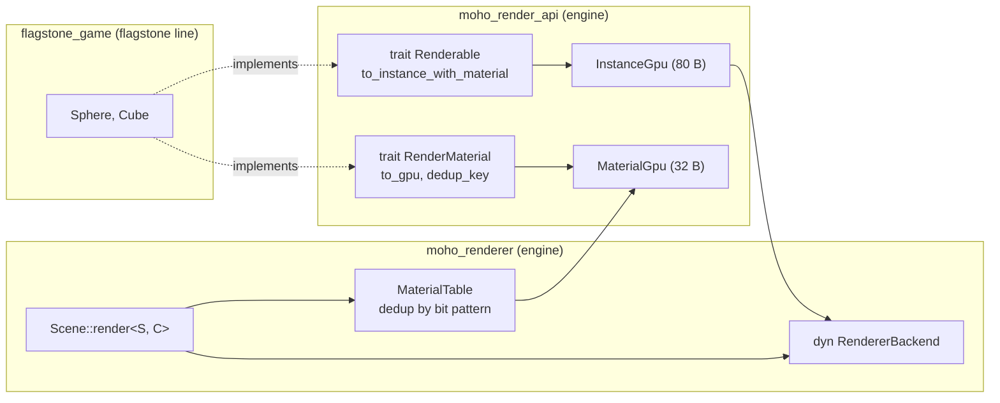
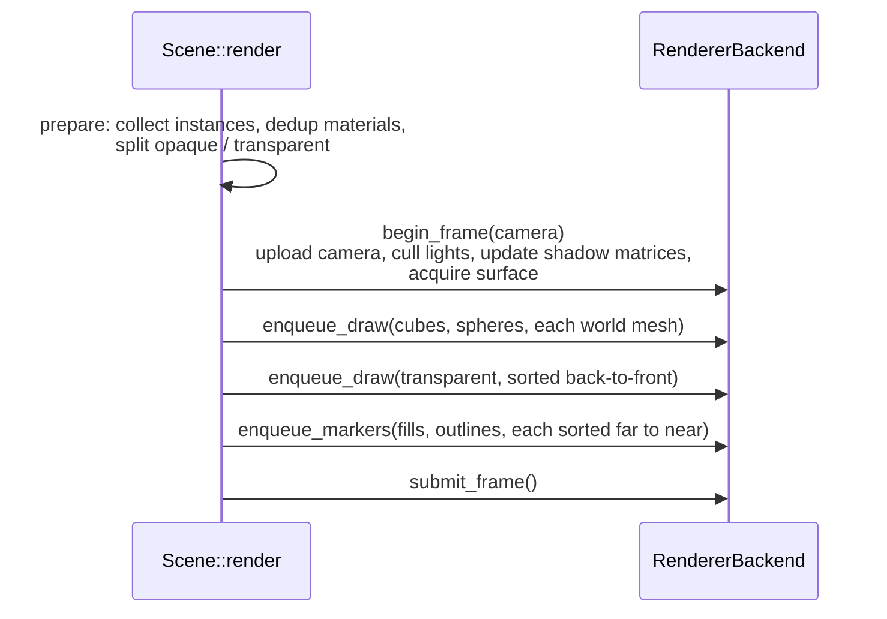
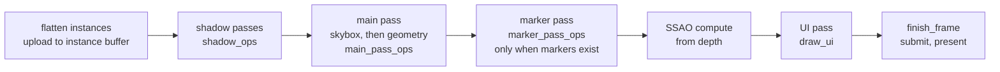

# Rendering

**Source:** `moho_render_api/src/` (`world_geometry.rs`), `moho_renderer/src/` (`scene.rs`,
`world_meshes.rs`, `markers.rs`, `renderer.rs`, `render_ops/`, `shadow.rs`, `ssao.rs`, `ui_pass/`), `moho_render_api/src/ui_paint.rs`, `moho_render_api/src/marker.rs`, `flagstone/src/app/world_geometry.rs`,
`shaders/`, `moho_level/src/`.
**Decisions:** [ADR-0001](../../_todo/adr/0001-render-api-boundary.md),
[ADR-0013](../../_todo/adr/0013-ui-reaches-the-renderer-as-paint-data.md).

## Boundary

The renderer never names a game type. Game types implement `Renderable` and
`RenderMaterial` from `moho_render_api`, and the renderer only sees `InstanceGpu` and
`MaterialGpu`.

`Scene::render` is generic over the actor types, so `moho_renderer` compiles without
`flagstone_game`.

## World geometry

World geometry reaches the renderer as meshes ([ADR-0010](../../_todo/adr/0010-world-geometry-is-a-mesh-contract.md)),
not as voxel types. `moho_render_api::WorldMesh` is an owned indexed mesh with one
`Vec` per vertex channel (position, normal, ao, light rgb, sky exposure, surface);
`WorldMesh::new` refuses mismatched channel lengths, out-of-range indices and partial
triangles (`WorldMeshError`). A `WorldMeshId` is the game-chosen stable key.

`moho_renderer::WorldMeshes` (reached via `Scene::world_meshes_mut`) queues
`upsert(id, mesh, material_idx)` and `remove(id)`. `Scene::render` calls `flush`
first: replaced or removed meshes are unregistered from the backend, new ones are
registered, and an empty mesh counts as a remove. Opaque world meshes are drawn one
draw per mesh in id order.

The binary adapts voxel chunks in `flagstone/src/app/world_geometry.rs`: `chunk_mesh_id` packs
the chunk position at 21 bits per signed axis, `chunk_world_mesh` converts a
`VoxelChunk`, and `insert_chunk` / `remove_chunk` keep the `ChunkStore`, the
renderer and the physics colliders in step. The same `WorldMesh` and `WorldMeshId` go to
`PhysicsWorld::set_world_mesh` / `remove_world_mesh` (`moho_physics/src/world.rs`), which
holds one static trimesh collider per id; an empty mesh holds none. A refused mesh is
logged and the chunk is neither drawn nor solid.

Each registration carries a `HitTag`, the game's own meaning for the surface (material,
team, body part), which the engine stores and never interprets. `PhysicsWorld::cast_ray`
(`moho_physics/src/world/query.rs`) takes a `RayQuery` and returns the nearest tagged
surface as a `RayHit` (point, normal facing back against the ray, distance, tag). Untagged
colliders, such as movement capsules and props, never stop a ray; `RayQuery::ignore` skips
one character. It reads the world as the last `step` left it. `PhysicsWorld::collider_tag`
turns a collider handle, such as the one a movement `Impact` reports, into its tag. The adapter tags chunks with
`TERRAIN_TAG` in `world_geometry.rs`.

`PhysicsWorld::add_hit_volume` (`moho_physics/src/world/character.rs`) attaches a tagged
`HitVolume` box, offset and sized in the character's body frame, for per-body-part hits.
Volumes are sensors parented to the character's body: they follow its position and yaw
(never pitch) on `step`, are removed with the character, never block movement or props,
and only rays see them. A ray ignoring a character skips its volumes too.

### Level files

`moho_level::load(path)` reads a `.gltf` or `.glb` file into a `Level`: one `LevelMesh`
(a `WorldMesh` plus the glTF material name) per triangle primitive reachable from the
default scene, plus a `LevelMarker` per named node without a mesh
(`moho_level/src/lib.rs`, `moho_level/src/marker.rs`). Rules:

- node transforms are baked into positions and normals; a mirroring transform flips
  triangle winding;
- positions and normals are required; ao, light, sky exposure and surface take neutral
  values (1, 0, 1, 0);
- buffers come from the GLB blob or a relative file URI beside the level; absolute
  paths and URL schemes are refused;
- non-triangle primitives are skipped with a warning; a node reached twice is an error;
- markers (spawns, loot points and the like) carry name, world position, world rotation
  (scale dropped) and `properties`, the node's `extras` object flattened to strings
  (non-string values become compact JSON; non-object or invalid extras are ignored with
  a warning). They arrive in scene-walk order; the loader gives them no meaning, game
  code interprets them;
- every failure is a `LevelError` naming the file, with a `LevelErrorKind`; no `gltf`
  type appears in the API.

The loader does not register meshes: the caller assigns `WorldMeshId`s and sends each
mesh to `WorldMeshes` and `PhysicsWorld` as above.

## Submission

`Scene::render` (called from the redraw handler) does CPU-side collection, then calls
the backend in a fixed sequence:

`begin_frame` returns `FrameError` if the surface can't be acquired; the frame is
skipped with a warning.

## Pass order

`submit_frame` flattens all pending draws into one instance buffer, then records one
command encoder:

The egui UI is drawn by the UI pass from paint data (below); `finish_frame` only submits
and presents. Shader sources are `shaders/*.wgsl` (`common`, `vertex`,
`fragment`, `shadow`, `skybox`, `gtao`, `ssao_blur`, `pcss`, `instance`, `ui`, `marker`).

## Markers

Markers are axis-aligned boxes a game places over the world (selection and mining
marks). `moho_render_api::Marker` holds `min`, `max` (world metres), a linear RGBA colour
with straight alpha and a `MarkerStyle`: `Fill` (translucent solid, the default) or
`Outline` (the twelve edges only). `Marker::new` orders the corners per axis and makes a
fill; `with_style` changes the style. A
`MarkerId` is the game-chosen stable key.

`moho_renderer::Markers` (reached via `Scene::markers_mut`) holds the live set in id
order: `upsert`, `remove`, `clear`. Markers persist until removed. `Scene::render` turns
them into `MarkerDraws` (`fills` and `outlines` lists of `MarkerGpu` instances; each box
grown by `MARKER_INFLATE` per side so a marker on a block face does not z-fight it, each
list sorted far to near by box centre) and passes both to `RendererBackend::enqueue_markers`.

`submit_frame` draws them in a separate pass after the main pass: colour and depth are
loaded, not cleared, so markers are depth-tested against the world; the pipeline writes no
depth, which keeps them out of the SSAO pass. One unit cube is instanced per marker and
scaled to its box in `shaders/marker.wgsl`. Fills draw first as a triangle list, then
outlines through a second pipeline over the same shader as a line list on the cube's edge
indices. Layout: [GPU ABI](../reference/gpu-abi.md).
The console drives them with `marker` and `marker_clear`
([console](console.md)).

## UI paint data

UI reaches the renderer as plain data ([ADR-0013](../../_todo/adr/0013-ui-reaches-the-renderer-as-paint-data.md)),
not as wgpu or egui types. `moho_render_api::UiFrame` holds `pixels_per_point`, texture
deltas (`UiTextureSet` before drawing, `UiTextureId` frees after) and `UiMesh`es
(clipped, textured triangle lists of `UiVertex`, in points). A game implements
`UiFrameSource` (`flagstone_ui`'s `EguiAdapter` maps egui tessellation in `adapter/paint_map.rs`)
and registers a `UiSource` with `RendererBackend::set_ui_source`; the
renderer pulls `Option<UiFrame>` once per frame with the surface size. The adapter
consumes egui's `TexturesDelta`; `textures_set` keeps the order of partial updates
to one texture, so patches apply after the full upload they follow.

`moho_renderer::ui_pass` draws it over the finished scene, before `finish_frame`. The pure
logic (`scissor`, `build_draws`, texture bookkeeping) is separate from the wgpu half
(`ui_pass/gpu.rs`). Meshes with an empty scissor, no indices or an unknown texture are
skipped; a non-finite or non-positive `pixels_per_point` skips the whole frame. The
painter and `shaders/ui.wgsl` are a port of `egui-wgpu` 0.34 (unchanged through 0.36): premultiplied-alpha
blending, sRGB vertex colours, no custom paint callbacks.

## Tunables

| Setting | Where | Notes |
|---|---|---|
| Shadow quality 0–4 | `graphics.shadow_quality`, `r_shadow_quality` | Off/Low/Med/High/Ultra |
| SSAO quality 0–4 | `graphics.ssao_quality`, `r_ssao_quality` | Samples 0/4/8/16/32 |
| Debug view | `r_debug_view <mode>` | `Lighting.params.y` |
| Shadow map size | `SHADOW_MAP_SIZE` = 4096 | `shadow.rs` |
| Shadow distance | `SHADOW_DISTANCE` = 1000 | `shadow.rs` |

CPU↔GPU struct layouts: [GPU ABI](../reference/gpu-abi.md).
