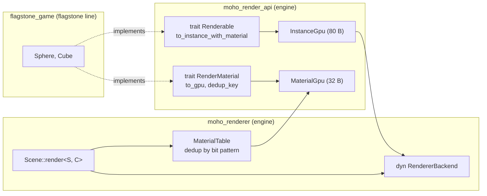
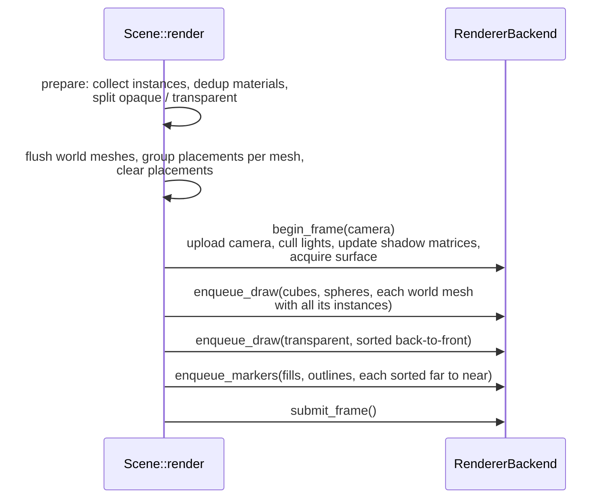
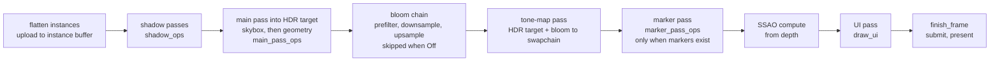

# Rendering

**Source:** `moho_render_api/src/` (`world_geometry.rs`, `texture.rs`), `moho_renderer/src/` (`scene.rs`, `sky.rs`,
`world_meshes.rs`, `textures.rs`, `markers.rs`, `renderer.rs`, `render_ops/`, `shadow.rs`, `ssao.rs`, `tone_map.rs`, `ui_pass/`), `moho_render_api/src/ui_paint.rs`, `moho_render_api/src/marker.rs`, `flagstone/src/app/world_geometry.rs`, `flagstone/src/app/cut_caps.rs`, `flagstone/src/app/view_level.rs`, `flagstone_voxel/src/mesh/cap.rs`,
`shaders/`, `moho_level/src/`.
**Decisions:** [ADR-0001](../../_todo/adr/0001-render-api-boundary.md),
[ADR-0013](../../_todo/adr/0013-ui-reaches-the-renderer-as-paint-data.md).

## 1 Boundary

The renderer never names a game type. Game types implement `Renderable` and
`RenderMaterial` from `moho_render_api`, and the renderer only sees `InstanceGpu` and
`MaterialGpu`.



`Scene::render` is generic over the actor types, so `moho_renderer` compiles without
`flagstone_game`.

## 2 World geometry

World geometry reaches the renderer as meshes ([ADR-0010](../../_todo/adr/0010-world-geometry-is-a-mesh-contract.md)),
not as voxel types. `moho_render_api::WorldMesh` is an owned indexed mesh with one
`Vec` per vertex channel (position, normal, ao, light rgb, sky exposure, surface);
`WorldMesh::new` refuses mismatched channel lengths, out-of-range indices and partial
triangles (`WorldMeshError`). A `WorldMeshId` is the game-chosen stable key. An optional
per-vertex `materials` channel (`with_materials`, one material-table index per vertex,
one material per triangle) lets a single mesh draw in several materials; without it
every vertex takes the `upsert` material. An optional `uvs` channel (`with_uvs`, one `[u, v]` per
vertex) carries base-colour texture coordinates (2.4). The renderer uploads the channel as `Vertex::material`,
and `shaders/vertex.wgsl` uses it unless it is `u32::MAX`, which defers to the instance's
material ([GPU ABI](../reference/gpu-abi.md)).

`moho_renderer::WorldMeshes` (reached via `Scene::world_meshes_mut`) queues
`upsert(id, mesh, material_idx)` and `remove(id)`. `Scene::render` calls `flush`
first: replaced or removed meshes are unregistered from the backend, new ones are
registered, and an empty mesh counts as a remove. A static mesh draws once at the
identity, one draw per mesh in id order.

A mesh that moves is uploaded once with `upsert_movable(id, mesh)` and drawn only where
the game places it ([ADR-0025](../../_todo/adr/0025-world-meshes-are-placed-per-frame.md)).
`place(id, Affine3A, material)` adds one copy for the current frame, any number per id and
on static meshes too; the mesh needs no `materials` channel, so the placement's material
applies. Placements on an id that is not live are skipped. `Scene::render` groups the
placements of a mesh into one instanced draw and clears them before `begin_frame`, so a
frame skipped for a lost surface consumes them too. Placed meshes cast and receive shadows
and take part in SSAO like static ones, and never touch physics. Normals use the cofactor
of the placement's upper 3x3 (`normal_to_world`, 2.2), so non-uniform scale lights correctly.

The binary adapts voxel chunks in `flagstone/src/app/world_geometry.rs`: `chunk_mesh_id` packs
the chunk position at 21 bits per signed axis, `chunk_world_mesh` converts a
`VoxelChunk`, and `insert_chunk` / `remove_chunk` keep the `ChunkStore`, the
renderer and the physics colliders in step, along with the chunk's [cut-face cap](#3-cut-face-caps). The same `WorldMesh` and `WorldMeshId` go to
`PhysicsWorld::set_world_mesh` / `remove_world_mesh` (`moho_physics/src/world.rs`), which
holds one static trimesh collider per id; an empty mesh holds none. A refused mesh is
logged and the chunk is neither drawn nor solid. When a chunk carries per-vertex voxel
materials, `TerrainPalette` (same file) maps each voxel material id to its material-table
index and `apply` writes the result into the mesh's `materials` channel.

Each registration carries a `HitTag`, the game's own meaning for the surface (material,
team, body part), which the engine stores and never interprets. `PhysicsWorld::cast_ray`
(`moho_physics/src/world/query.rs`) takes a `RayQuery` and returns the nearest tagged
surface as a `RayHit` (point, normal facing back against the ray, distance, tag). Untagged
colliders, such as movement capsules and props, never stop a ray; `RayQuery::ignore` skips
one character. It reads the world as the last `step` left it. `PhysicsWorld::collider_tag`
turns a collider handle, such as the one a movement `Impact` reports, into its tag. The adapter tags chunks with
`TERRAIN_TAG` in `world_geometry.rs`.

`PhysicsWorld::set_hit_volumes` (`moho_physics/src/world/character.rs`) replaces a
character's tagged `HitVolume` boxes, each posed (offset and rotation) and sized in the
character's body frame, for per-body-part hits. Volumes are sensors parented to the character's body: they follow its position and yaw
(never pitch) on `step`, are removed with the character, never block movement or props,
and only rays see them. A ray ignoring a character skips its volumes too. New volumes are defined for rays only after the next `step`, so a game poses volumes before stepping and resolves shots after.

### 2.1 Level files

`moho_level::load(path)` reads a `.gltf` or `.glb` file into a `Level`: one `LevelMesh`
(a `WorldMesh` plus the glTF material name) per triangle primitive reachable from the
default scene, plus a `LevelMarker` per named node without a mesh
(`moho_level/src/lib.rs`, `moho_level/src/marker.rs`). Rules:

- node transforms are baked into positions and normals; a mirroring transform flips
  triangle winding;
- positions and normals are required; ao, light, sky exposure and surface take neutral
  values (1, 0, 1, 0);
- buffers come from the GLB blob or a relative file URI beside the level; absolute
  paths and URL schemes are refused;
- non-triangle primitives are skipped with a warning; a node reached twice is an error;
- markers (spawns, loot points and the like) carry name, world position, world rotation
  (scale dropped) and `properties`, the node's `extras` object flattened to strings
  (non-string values become compact JSON; non-object or invalid extras are ignored with
  a warning). They arrive in scene-walk order; the loader gives them no meaning, game
  code interprets them;
- every failure is a `LevelError` naming the file, with a `LevelErrorKind`; no `gltf`
  type appears in the API.

The loader does not register meshes: the caller assigns `WorldMeshId`s and sends each
mesh to `WorldMeshes` and `PhysicsWorld` as above.

### 2.2 Model files

`moho_level::load_model(path)` reads the same glTF dialect into a `Model`
(`moho_level/src/model.rs`; [ADR-0024](../../_todo/adr/0024-models-are-gltf-data-placed-by-node.md)).
It shares the buffer rules and `LevelError` of 2.1, but keeps node structure instead of baking it:

- `Model` is immutable data: `ModelNode`s in walk order (name, parent index always lower than
  the node's own, `local` and `rest` transforms), `ModelMesh`es (a `WorldMesh` in node space, node
  index, optional material index), `ModelMaterial`s (name, linear base colour, optional image index; 2.4)
  and `ModelImage`s. No GPU handles,
  no per-instance state;
- the game uploads each mesh once as movable and, each frame, places it at the transform
  `Model::placements(root)` yields (`root * rest`); posing feeds placement and never mutates the
  model;
- `ModelMaterial` implements `RenderMaterial` under `MODEL_MATERIAL_VARIANT`; the game owns mesh
  ids and material indices;
- a glTF mesh shared by several nodes is converted once per node;
- the vertex shader transforms normals by the cofactor of the instance's upper 3x3 (`normal_to_world`
  in `shaders/vertex.wgsl`), so non-uniform scale lights correctly. A mirrored root draws
  inside-out under back-face culling, so games place with positive-determinant roots.

The game glue, once per model and once per frame:

```rust
// Load time: one id per model mesh, each uploaded once; each material registered once.
for (mesh, &id) in model.meshes().iter().zip(&ids) {
    world_meshes.upsert_movable(id, mesh.mesh.clone());
}
let mats: Vec<u32> = model
    .meshes()
    .iter()
    .map(|m| materials.find_or_push(model.material_of(m)))
    .collect();

// Each frame: no mesh data moves, only transforms.
for (i, t) in model.placements(root) {
    world_meshes.place(ids[i], t, mats[i]);
}
```

### 2.3 Sockets

`Assembly<K>` (`moho_level/src/socket.rs`) is one drawn copy of a model, keyed by the game's
model key `K`, with other assemblies attached at its named nodes, nested. Each copy holds its own
parts, so two rifles from one model can carry different scopes; the shared `Model` never changes.

- Every method takes a `K -> &Model` lookup, so the assembly holds no models. The lookup must
  return the same model for a key for the assembly's whole life: sockets resolve to node indices
  at attach time.
- `attach` puts a part at the first node of that name in walk order, with an offset in the node's
  space. A node holds one part: attaching again replaces it in place (same position in attach
  order) and returns the old part. `detach` removes and returns it; `part_mut` reaches it to
  attach to it in turn. An unknown name is `SocketError::UnknownSocket` and leaves the assembly
  unchanged.
- `placements(models, root)` yields `(model key, mesh index, transform)`: this copy's meshes
  first, then each part in attach order, depth-first, the part's root being
  `root * socket_node.rest * offset`. Sockets use rest transforms, not posed ones.

The game glue keeps one `Assembly` per drawn copy and the per-model ids and materials of 2.2,
indexed by key. A swap shows on the next frame drawn:

```rust
for (k, i, t) in copy.placements(&|k| &models[k], root) {
    world_meshes.place(ids[k][i], t, mats[k][i]);
}
```

### 2.4 Base-colour textures

A placed mesh can draw with a base-colour image (`moho_render_api/src/texture.rs`,
`moho_renderer/src/textures.rs`):

- `Rgba8Image` is straight-alpha sRGB RGBA8, row-major from the top-left; `Rgba8Image::new`
  refuses a zero dimension or a pixel count that is not `width * height` (`ImageSizeError`).
  `TextureId` is the game-chosen key.
- `WorldMeshes::upsert_texture(id, image)` / `remove_texture(id)` queue changes that `flush`
  applies through `RendererBackend::register_texture` (returns a handle; full mip chain) and
  `unregister_texture`. `place_textured(id, transform, material, texture)` is `place` with a
  texture; a texture id that is not live draws white. Placed meshes draw opaque: the texel's alpha
  is ignored.
- The backend's `register_world_mesh` uploads a mesh's `uvs` (`[0, 0]` when absent), and
  `enqueue_textured_draw` binds the texture for a draw. Handle 0 is a 1x1 white texture,
  the default for every other draw and for backends that do not texture.
- The main pass binds the texture at group 2 ([GPU ABI](../reference/gpu-abi.md)). The fragment
  shader multiplies the lit albedo (terrain voxel albedo included) by the texel's rgb.
- `moho_level::load_image(path)` decodes a PNG or JPEG (by content) to `Rgba8Image`;
  `load_model` also decodes each base-colour image a material uses into `Model::images()`
  (`ModelImage`: name, canonical source path or `None` when embedded, pixels), referenced by
  `ModelMaterial::base_colour_image`. Images come from a buffer view or a relative file beside
  the model; a missing file is `LevelErrorKind::MissingImage`, an unsupported or undecodable one
  `BadImage`. A textured primitive without `TEXCOORD_0` is a `BadMesh` error; other texcoord
  sets are read as set 0 with a warning.

The game glue extends 2.2's: each image is uploaded once, keyed by its source file so models
sharing a file share the texture (an embedded image is keyed by model and index), and a mesh whose
material has an image is placed with it:

```rust
// Load time: one TextureId per image; `texture_key` maps a source path (or model and index) to it.
let textures: Vec<TextureId> = model
    .images()
    .iter()
    .enumerate()
    .map(|(i, img)| {
        let id = texture_key(img.source.as_deref(), model_id, i);
        world_meshes.upsert_texture(id, img.image.clone());
        id
    })
    .collect();

// Each frame: textured meshes name their texture, the rest place as before.
for (i, t) in model.placements(root) {
    let mesh = &model.meshes()[i];
    match model.material_of(mesh).base_colour_image {
        Some(img) => world_meshes.place_textured(ids[i], t, mats[i], textures[img]),
        None => world_meshes.place(ids[i], t, mats[i]),
    }
}
```

## 3 Cut-face caps

The strategy HUD's view-height slider (`RtsHud`, `ViewHeightHud`) chooses the cut as a block
layer. `flagstone/src/app/view_level.rs` (`ViewLevel`, `LayerExtent`) holds the pick: the
extent is the layer span of the loaded chunks (`floor + 1 ..= top`), the top means no cut, and
the cut sits `CUT_ABOVE_LAYER` over the layer boundary. `Game::frame` takes the pick from
`EguiAdapter::take_hud_intents` and calls `view_level::update`, which sends a changed cut to
the caps (`set_cut`) and the renderer (`RenderRequest::ViewHeight`). In first person the
renderer gets no cut. `update_hud_data` feeds the current level back to the slider.

The view-height cut discards geometry above the plane and leaves the ground hollow.
The binary closes it with flat caps built from the voxels, not by the renderer.
`flagstone/src/app/cut_caps.rs` (`CutCaps`) follows the cut: `view_level::update` and
`SetViewHeight` set it (`set_cut`), chunk insert and upsert mark the chunk dirty, remove drops its cap at once, and
`FrameProcessor::update_cut_caps` runs `refresh` each frame before lighting and render.
`refresh` rebuilds caps only for dirty chunks, plus, when the cut moved, every chunk in
`cap_chunk_layers` and every chunk already capped. A cap is an ordinary world mesh queued
under `cap_mesh_id` (the chunk's id with bit 63 set) with the cut-face material
(`register_cut_face_material`: terrain dirt on both faces) as its default; each cap triangle
carries the face material of the ground it cuts, picked by the same nearest-solid-block
rule as the walls (`nearest_solid_corner`), so cap and wall edges line up. Caps get no collider and are
removed with their chunk or when the cut clears.

`flagstone_voxel::cut_cap_mesh` (`mesh/cap.rs`) builds the `+Y` face at `y = cut` over
the cells the chunk's own mesher drew, at the chunk's LOD, so the cap meets the walls and
neighbouring caps tile. Solidity is sampled at `cut + CAP_PROBE`. A marker whose top sits
on the cut keeps its lid: `shaders/marker.wgsl` discards above the cut plus the
`marker_inflate` pipeline constant, set from `MARKER_INFLATE`.

## 4 Submission

`Scene::render` (called from the redraw handler) does CPU-side collection, then calls
the backend in a fixed sequence:



`begin_frame` returns `FrameError` if the surface can't be acquired; the frame is
skipped with a warning.

## 5 Pass order

`submit_frame` flattens all pending draws into one instance buffer, then records one
command encoder:



The egui UI is drawn by the UI pass from paint data (below); `finish_frame` only submits
and presents. Shader sources are `shaders/*.wgsl` (`common`, `sky`, `vertex`,
`fragment`, `shadow`, `skybox`, `gtao`, `ssao_blur`, `pcss`, `instance`, `ui`, `marker`, `bloom`, `tonemap`).

The skybox and main pipelines render into an `Rgba16Float` HDR target (`tone_map::HdrTarget`,
recreated on resize), not the swapchain. `bloom::BloomChain` (`shaders/bloom.wgsl`, after
Jimenez 2014) then blurs its bright pixels into an `Rgba16Float` mip chain, one render pass
per step: a 13-tap prefilter with the Karis average and a soft-knee threshold
(`bloom_threshold` 1.0, `bloom_knee` 0.25, pipeline overrides) from the HDR target into
mip 0, 13-tap downsamples down the chain, then 3×3 tent upsamples blended additively back
up it. High starts at half resolution with 6 levels, Low at quarter with 5
(`mip_extents`); the mips are recreated on resize and on a quality change
(`RendererBackend::set_bloom_quality`). A pixel at or below the threshold adds nothing.
`tone_map::ToneMapPass` then resolves the HDR target to the swapchain in
`shaders/tonemap.wgsl`: mip 0 added at `bloom_intensity` (0.5 / level count, so Low and
High are equally strong), exposure multiplier, then a hue-preserving highlight roll-off
(identity below 0.76). Bloom Off skips the chain, sets the intensity to 0 and binds a 1×1
black texture, so the frame matches no bloom exactly. With the curve off the bloomed HDR
scene is copied unchanged. Markers and the UI draw after it, straight onto the swapchain,
so none of them is tone-mapped or bloomed.

Present mode: the surface starts on `Fifo` and the renderer keeps the present modes the
surface supports. `RendererBackend::set_vsync(on)` picks the mode with
`device::choose_present_mode` and reconfigures the surface, the same path as `resize`.
On gives `Fifo`. Off gives `Immediate`, else `Mailbox`, else `Fifo` with a fallback
reason, which `Renderer::set_vsync` logs at `warn`. `FifoRelaxed` is never chosen. The
trait method is a no-op by default.

### 5.1 Light composition

The last lighting step in `shaders/fragment.wgsl` combines the two per-vertex light
channels:

```wgsl
color = celestial * max(sky_exposed, MIN_SKY_AMBIENT)   // sun and moon
      + ao * point_light_contrib
      + sky_ambient
      + sky_reflected
      + albedo * ao * block_light_rgb * BLOCK_LIGHT_GAIN
```

Sky exposure gates the sun and moon terms (floor `MIN_SKY_AMBIENT` = 0.1). Point lights
are not gated. Sky ambient is separate: an ambient cube over the sky palette (zenith up,
ground down, horizon on the sides) weighted by the normal, scaled by `ambient.w`, sky
exposure and a multibounce AO term. The palette is computed per frame from the time of
day in `moho_renderer/src/sky.rs` and shared by the skybox.

Sky reflection (`sky_reflected`) is the sky gradient mirrored by metals (`fuzz` as roughness),
dielectrics (Fresnel) and glossy world meshes (`MaterialGpu.albedo.w`, roughness `1 - gloss`),
scaled by sky exposure outright, so a covered surface reflects nothing; debug view 7 shows it alone.
`shaders/sky.wgsl` holds `sky_gradient`, concatenated ahead of both the main and skybox shaders
(`main_shader_source`, `skybox_shader_source`), so a mirror shows the sky the player sees.

Block light adds on top, so torches and emissive blocks light caves and night surfaces the sky
leaves dark. A surface with no block light (entity meshes, level files) draws as sky
exposure alone. Block light next to a strong emitter can push a channel past 1;
`BLOCK_LIGHT_GAIN` (1.0) is the tuning knob.

## 6 Markers

Markers are axis-aligned boxes a game places over the world (selection and mining
marks). `moho_render_api::Marker` holds `min`, `max` (world metres), a linear RGBA colour
with straight alpha and a `MarkerStyle`: `Fill` (translucent solid, the default) or
`Outline` (the twelve edges only). `Marker::new` orders the corners per axis and makes a
fill; `with_style` changes the style. A
`MarkerId` is the game-chosen stable key.

`moho_renderer::Markers` (reached via `Scene::markers_mut`) holds the live set in id
order: `upsert`, `remove`, `clear`. Markers persist until removed. `Scene::render` turns
them into `MarkerDraws` (`fills` and `outlines` lists of `MarkerGpu` instances; each box
grown by `MARKER_INFLATE` per side so a marker on a block face does not z-fight it, each
list sorted far to near by box centre) and passes both to `RendererBackend::enqueue_markers`.

`submit_frame` draws them in a separate pass after the main pass: colour and depth are
loaded, not cleared, so markers are depth-tested against the world; the pipeline writes no
depth, which keeps them out of the SSAO pass. One unit cube is instanced per marker and
scaled to its box in `shaders/marker.wgsl`. Fills draw first as a triangle list, then
outlines through a second pipeline over the same shader as a line list on the cube's edge
indices. Layout: [GPU ABI](../reference/gpu-abi.md).
The console drives them with `marker` and `marker_clear`
([console](console.md)).

## 7 UI paint data

UI reaches the renderer as plain data ([ADR-0013](../../_todo/adr/0013-ui-reaches-the-renderer-as-paint-data.md)),
not as wgpu or egui types. `moho_render_api::UiFrame` holds `pixels_per_point`, texture
deltas (`UiTextureSet` before drawing, `UiTextureId` frees after) and `UiMesh`es
(clipped, textured triangle lists of `UiVertex`, in points). A game implements
`UiFrameSource` (`flagstone_ui`'s `EguiAdapter` and `moho_ui_shell`'s `UiShell` map egui tessellation through `moho_ui_shell/src/paint_map.rs`)
and registers a `UiSource` with `RendererBackend::set_ui_source`; the
renderer pulls `Option<UiFrame>` once per frame with the surface size. Several sources reach
the one slot through `moho_ui_shell::UiLayers`, which merges them in order, later on top. The adapter
consumes egui's `TexturesDelta`; `textures_set` keeps the order of partial updates
to one texture, so patches apply after the full upload they follow.

`moho_renderer::ui_pass` draws it over the finished scene, before `finish_frame`. The pure
logic (`scissor`, `build_draws`, texture bookkeeping) is separate from the wgpu half
(`ui_pass/gpu.rs`). Meshes with an empty scissor, no indices or an unknown texture are
skipped; a non-finite or non-positive `pixels_per_point` skips the whole frame. The
painter and `shaders/ui.wgsl` are a port of `egui-wgpu` 0.34 (unchanged through 0.36): premultiplied-alpha
blending, sRGB vertex colours, no custom paint callbacks.

## 8 Tunables

| Setting | Where | Notes |
|---|---|---|
| Shadow quality 0–4 | `graphics.shadow_quality`, `r_shadow_quality` | Off/Low/Med/High/Ultra |
| SSAO quality 0–4 | `graphics.ssao_quality`, `r_ssao_quality` | Samples 0/4/8/16/32 |
| Brightness 0.5–2.0 | `graphics.brightness`, Video tab slider | Linear exposure multiplier into the tone-map pass (`RendererBackend::set_brightness`, `brightness_exposure`); clamped, NaN gives 1.0; applied at start by `apply_saved_render_settings` |
| Bloom 0–2 | `graphics.bloom`, `r_bloom <0-2>`, Video tab combo | Off/Low/High; applied at start by `apply_saved_render_settings` |
| Tone map 0/1 | `r_tonemap <0\|1>` | `RendererBackend::set_tone_map`; session-only, on at start, not saved |
| Debug view | `r_debug_view <mode>` | `Lighting.params.y` |
| View-height cut | `r_view_height <metres\|off>` | `Renderer::set_view_height`; sticky; cuts world, markers and shadows; the binary caps the cut ([below](#3-cut-face-caps)) |
| Shadow map size | `SHADOW_MAP_SIZE` = 4096 | `shadow.rs` |
| Shadow distance | `SHADOW_DISTANCE` = 1000 | `shadow.rs` |

CPU↔GPU struct layouts: [GPU ABI](../reference/gpu-abi.md).
