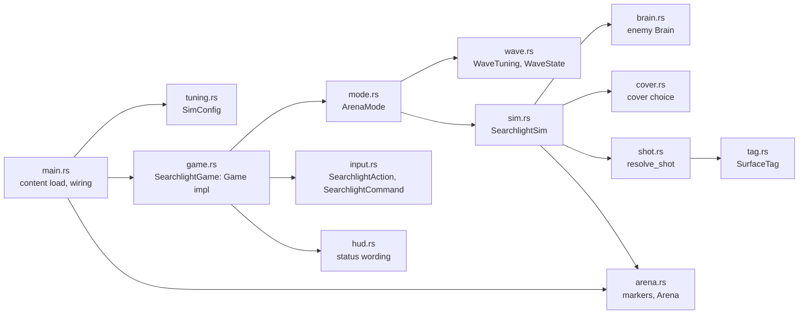

# Searchlight

**Source:** `searchlight/src/`, `moho_level/src/nav.rs`, `searchlight/assets/`, `searchlight/content/`, `moho_ui_shell/src/`.
**Decisions:** [ADR-0015](../../_todo/adr/0015-fps-rules-are-a-platform-free-crate.md),
[ADR-0017](../../_todo/adr/0017-ui-shell-and-debug-values-are-engine-seams.md),
[ADR-0019](../../_todo/adr/0019-navigation-is-an-engine-seam.md).

`searchlight` is the FPS line's engine adapter: a library and the `searchlight` binary. Rules
(`Rifle`, `Magazine`, `Body`, `BodyProfile`) come from `searchlight_rules`; windowing, loop,
physics, level loading, input, audio and rendering come from engine crates. It depends on no
strategy crate ([overview](overview.md#2-lines-and-rules)).

## 1 Layers

| Module | Role |
|---|---|
| `arena` | Loads `assets/arena.glb` through `moho_level`; `ArenaMarkers` sorts named markers by kind and orders waypoints into the patrol route; `Arena` is the loaded level the sim starts from (meshes, spawns, route, cover points, `nav`) and builds the world colliders; `Arena::from_level` also builds the `NavMesh` for `nav_profile` (the player-sized capsule plus clearance) and fails with `ArenaError::Nav` when that fails; it also drops waypoints no enemy spawn has a navmesh path to (logged as a warning) and fails with `ArenaError::NoReachableWaypoint` when none is left |
| `tuning` | `tuning(&RifleDef)`: builds the `SimConfig`, taking the rifle's numbers from the definition |
| `input` | `SearchlightAction` set and default bindings; `build_action_map` builds the `ActionMap` at startup, with mouse look (`look_settings`: sensitivity, smoothing, invert Y) taken from `Prefs`, and a sensitivity not above zero falling back to the default 3.0; `SearchlightCommand::from_frame` builds the per-tick command from an `ActionFrame` (fire, reload, check magazine, restart on Enter) |
| `tag` | `SurfaceTag` (`World`, `Part { target, part }` or `Player(part)`) and its lossless round trip through the engine's opaque `moho_physics::HitTag` |
| `shot` | `resolve_shot`: first tagged surface along a `ShotRay` in the `PhysicsWorld` |
| `brain` | `Brain`: the enemy state machine (`Patrol`, `Engage`, `Cover`, `Chase`), pure over `glam` types; `Percept` and a `steer` function in, `Intent` out; `EnemyTuning` holds its numbers |
| `cover` | `pick` and `offer`: choose the nearest free cover point a hurt enemy should run to, using world-only rays against the player (`Threat`) |
| `sim` | `SearchlightSim`: player character and body, rifle, spare magazines, dummies and enemies; emits `Feedback`; counts player kills |
| `wave` | `WaveTuning` (first wave size, growth per wave, points per kill; zero size or growth is refused) and `WaveState` (running wave, enemies still to spawn, score) as plain numbers, no physics |
| `mode` | `ArenaMode`: the arena as a game mode. Owns a `SearchlightSim` started empty, scores its kills and spawns each wave's enemies at free enemy markers |
| `hud` | Text for rifle state, hits, health, death and the wave and score line; the hit-edge direction; the death overlay |
| `console_commands` | Builds the FPS `Console` from the game's `[bindings]`; the game's own commands register here (`tgm`, parsed into `ConsoleCommand`) |
| `debug_settings` | `DebugSettings`: the loaded `Prefs` and its path; reads and saves the game's `[debug]` values (`god_mode`) |
| `game` | `SearchlightGame`, the `moho_app::Game` implementation: samples look every frame while focused and the console is closed (the camera draws the sim turned by the pending look, and `input::look_to_turn` is the one look mapping for command and camera), samples input, ticks the `ArenaMode`, turns `Feedback` into sound, title status line, hit flash, damage-direction edge, death tint and crosshair; asks the loop to pause while the shell captures input (console open), so the sim freezes instead of ticking with an ignored command; while it does, `command()` still applies console commands but does not end the action-map tick, so the look already shown stays pending and is not lost |

`SearchlightSim` holds no renderer, audio or UI handle, so it runs under `moho_app::HeadlessLoop`.
`Feedback` is the only output: `SearchlightSim::tick` queues it, the game drains it
(`drain_feedback`) and reacts. `TICK_HZ` is 60. The rifle's numbers (damage, cooldown, reload, range, magazine size) load from
`content/weapons.toml`, then the mods listed in prefs (`mods/<name>/weapons.toml`), at start ([content format](../reference/content-format.md)); a load failure
exits the binary. `tuning::tuning` combines them with the numbers still set in code (speeds, body
profile, `EnemyTuning`, the player part enemies aim at) as a `SimConfig`.

## 2 Console

`SearchlightGame` owns a `moho_ui_shell::UiShell` behind an `Arc<Mutex<_>>` and composes it with the
crosshair through `UiLayers` as the renderer's one UI source. Every key and button goes to the
shell first (`route_input`): the console toggle key opens it, `release_all` drops held game keys,
and while it is open input does not reach the game. Escape closes the console instead of
exiting. Engine commands typed in the console (`quit`, `r_debug_view`, `r_shadow_quality`,
`r_ssao_quality`, `audio_cue`) return as `EngineCommand` values and apply on the next
frame through `apply_engine_command`, which reaches the renderer (`RendererBackend`) and audio
through `FrameContext`; with neither present the command is dropped. Console commands are hidden debug commands
([ADR-0017](../../_todo/adr/0017-ui-shell-and-debug-values-are-engine-seams.md)).

The shell can also draw game text (searchlight does not use it yet): `UiShell::set_texts(Vec<ScreenText>)`
replaces the anchored lines the next `ui_frame` paints under the console, and that frame clears them, so a
game sets its full text every `Game::frame`. A frame the renderer skips leaves no stale text. Use a few
fixed sizes; each new size grows the font atlas.

Game commands (`tgm [0|1]`) queue as `ConsoleCommand` on the console. `SearchlightGame` drains them
at the start of each `command()` sample (`apply_console_commands`), applies them in order, saves
a changed value through `DebugSettings` (a failed save is logged, not fatal) and echoes a bare
toggle's result to the console. God mode is loaded from `[debug]` at start (`with_debug_settings`)
and carried on every tick as `SearchlightCommand::god_mode`. While on, enemy hits still emit
`Feedback::PlayerHit` but do not damage the player's `Body`; it does not revive a dead player.
The title status line appends `GOD MODE` (`hud::god_mode_text`).

## 3 Tick

`SearchlightSim::tick(command, dt)` lets the enemies perceive and move, moves the player character,
steps the physics world, applies weapon actions, then resolves the shots the enemies decided
on and removes enemies that died. The rifle is in one state at a time (ready, cooling down
after a shot, reloading); cooldown and reload are tick counts.

`SearchlightSim::start(arena, config)` builds the full sim: targets are numbered dummies first, then
enemies. `SearchlightSim::new` builds one with dummies only. A sim started from an arena keeps the
`Arena` and `SimConfig`; once the player is dead, `tick` reads only `SearchlightCommand::restart` and
rebuilds the sim from them.

## 4 Waves

`ArenaMode::new(arena, config, waves)` builds the sim with `Start::Empty` (`SearchlightSim::with_start`):
dummies and the player stand, enemy markers are remembered but unoccupied. Each
`ArenaMode::tick` runs the sim, then `WaveState::step` with the sim's new kills and the number of
free markers (`SearchlightSim::free_enemy_spawns`: no living character within two `CAPSULE_RADIUS`) and
spawns that many enemies through `SearchlightSim::spawn_enemy`. Wave 1 holds `first_size` enemies and each
later wave `growth` more; the next wave begins when the current one has nothing left to spawn and
none alive. Spawned enemies take the next target number after the dummies; the dead keep theirs.
Nothing spawns while the player is dead; the restart rebuilds the sim empty and begins wave 1
with no score. `SearchlightGame` reads `wave()` and `score()` for the HUD.

## 5 Enemies

Each tick an enemy casts a sight ray from its eye to the player's aim point (the part chosen
by `SimConfig::enemy_aim_at`) and sets `Percept::target` only when that ray strikes a
`SurfaceTag::Player`, so walls block sight. `Brain::think` returns an `Intent` (forward
fraction, yaw delta, fire). `Patrol` walks the route in order, wrapping, heading for the next corner of the navmesh path to the waypoint (the same `steer` as `Chase`; straight at the waypoint when there is no path), with arrival measured to the waypoint; a target inside
`sight_range` and `view_half_angle` starts `Engage`, which stands and faces the target while it
stays visible, fires after `reaction_ticks` of continuous sight, within `fire_cone` of the
bearing and off cooldown. Aim error comes from the `searchlight.enemy_spread` `SimRng` stream, started from
`EnemyTuning::seed`, so runs repeat and a restart replays a fresh start.

When the player wounds an enemy (a non-lethal hit), the sim records the player's position on
that enemy (`Target::hurt`) and, from the `Arena` cover points, asks `cover::offer` for a
point within `cover_range` that no other enemy holds (`Brain::claim`), that the player cannot
see at `cover_hide_height`, and from which a standing enemy can still shoot the player.
The next `Percept` carries `hurt` and `offer`. With an offer a `Patrol`, `Chase` or unheld
`Engage` brain enters `Cover`: it runs at full speed to the point, then `Engage`s there
holding the claim. After `cover_ticks` without arriving it fights where it stands. Without an
offer it turns to `Engage` on the shooter's position. An `Engage` that loses sight falls to
`Chase`, walking to the last seen position until it arrives or `chase_ticks` pass, then
resumes `Patrol`; sight during `Chase` re-engages. `Chase` heads for the next corner (the one after
its own position) of the `moho_level::NavMesh` path from the enemy to the last seen position (`SearchlightSim` supplies
this as `steer`, with the goal first dropped onto the floor below it, so a player lost mid-jump is still chased), so enemies walk around obstacles; arrival is still measured to the last seen
position. With no path (the position is off the mesh or unreachable) the enemy resumes `Patrol`
at once. Sight and shot rays are not affected by the navmesh. Enemy shots use the shot path below; a hit on the player emits
`Feedback::PlayerHit`, and a dead player emits `Feedback::PlayerDied`.

## 6 Shot path

Player and enemy shots go through one route:

1. `ShotRay` from the eye with range and the shooter's `CharacterHandle` as `ignore`.
2. `PhysicsWorld::cast_ray` returns the first collider hit and its `HitTag`.
3. `SurfaceTag::try_from` decodes the tag; an unknown tag is logged and counts as a miss.
4. A `Part` strike (dummy or enemy) or a `Player` strike applies damage through `Body` in `searchlight_rules`.

Tag encoding: `0` is `World`; a `Part` is `1 + ((target << 3) | part_index)`, with
`part_index` the position in `PARTS`; `Player(part)` is `PLAYER_BASE + part_index`, with
`PLAYER_BASE` above every `Part` tag (`tag.rs`). Dummies and enemies carry six hit volumes
(`dummy_hit_volumes`), one per `BodyPart`, tagged with the target number; the player carries the
same boxes tagged `Player` (`player_hit_volumes`).

## 7 Arena contract

Markers are node names in the glTF file. `player_spawn` is required and unique; at least one
`dummy_NN` is required; `enemy_spawn_NN` and `cover_NN` are optional (cover points feed `Arena::covers`; without them hurt enemies stand and fight; full-height `screen_NN` walls are plain geometry with no marker). `waypoint_NN` is optional
unless an `enemy_spawn_NN` exists, then at least one is required (`ArenaError::MissingMarker`);
the patrol route follows the waypoint numbers, not file order. A waypoint that no enemy spawn can walk to is dropped from the route with a warning; if enemy spawns exist and no waypoint is reachable, loading fails with `ArenaError::NoReachableWaypoint`. Waypoints are not checked when there are no enemy spawns. Each
`cover_NN` carries a `shielded_from` extra (`+x`, `-x`, `+z`, `-z`). Spawns are floor points;
`SearchlightSim::new` lifts capsule centres by `STAND_HEIGHT`. Errors surface as `ArenaError`.

`assets/arena.glb` and `assets/rifle_shot.wav` are generated by
`assets/tools/make_arena.py`; see [`assets/README.md`](../../searchlight/assets/README.md) for
regeneration and licence. A replacement arena must keep the marker names.
