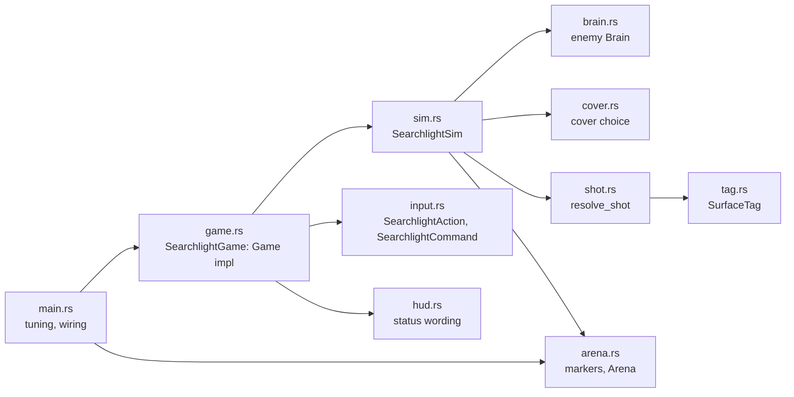

# Searchlight

**Source:** `searchlight/src/`, `searchlight/assets/`, `moho_ui_shell/src/`.
**Decisions:** [ADR-0015](../../_todo/adr/0015-fps-rules-are-a-platform-free-crate.md),
[ADR-0017](../../_todo/adr/0017-ui-shell-and-debug-values-are-engine-seams.md).

`searchlight` is the FPS line's engine adapter: a library and the `searchlight` binary. Rules
(`Rifle`, `Magazine`, `Body`, `BodyProfile`) come from `searchlight_rules`; windowing, loop,
physics, level loading, input, audio and rendering come from engine crates. It depends on no
strategy crate ([overview](overview.md#lines-and-rules)).

## Layers

| Module | Role |
|---|---|
| `arena` | Loads `assets/arena.glb` through `moho_level`; `ArenaMarkers` sorts named markers by kind and orders waypoints into the patrol route; `Arena` is the loaded level the sim starts from (meshes, spawns, route, cover points) and builds the world colliders |
| `input` | `SearchlightAction` set and default bindings; `SearchlightCommand::from_frame` builds the per-tick command from an `ActionFrame` (fire, reload, check magazine, restart on Enter) |
| `tag` | `SurfaceTag` (`World`, `Part { target, part }` or `Player(part)`) and its lossless round trip through the engine's opaque `moho_physics::HitTag` |
| `shot` | `resolve_shot`: first tagged surface along a `ShotRay` in the `PhysicsWorld` |
| `brain` | `Brain`: the enemy state machine (`Patrol`, `Engage`, `Cover`, `Chase`), pure over `glam` types; `Percept` in, `Intent` out; `EnemyTuning` holds its numbers |
| `cover` | `pick` and `offer`: choose the nearest free cover point a hurt enemy should run to, using world-only rays against the player (`Threat`) |
| `sim` | `SearchlightSim`: player character and body, rifle, spare magazines, dummies and enemies; emits `Feedback` |
| `hud` | Text for rifle state, hits, health and death; the hit-edge direction; the death overlay |
| `console_commands` | Builds the FPS `Console` from the game's `[bindings]`; the game's own commands register here (none yet, so only the engine's `help`, `clear` and `quit` run) |
| `game` | `SearchlightGame`, the `moho_app::Game` implementation: samples input, ticks the sim, turns `Feedback` into sound, title status line, hit flash, damage-direction edge, death tint and crosshair |

`SearchlightSim` holds no renderer, audio or UI handle, so it runs under `moho_app::HeadlessLoop`.
`Feedback` is the only output: `SearchlightSim::tick` queues it, the game drains it
(`drain_feedback`) and reacts. `TICK_HZ` is 60. Tuning values (speeds, damage, cooldown,
magazine size, body profile, `EnemyTuning`, the player part enemies aim at) live in `main.rs` as a `SimConfig`.

## Console

`SearchlightGame` owns a `moho_ui_shell::UiShell` behind an `Arc<Mutex<_>>` and composes it with the
crosshair through `UiLayers` as the renderer's one UI source. Every key and button goes to the
shell first (`route_input`): the console toggle key opens it, `release_all` drops held game keys,
and while it is open input does not reach the game. Escape closes the console instead of
exiting. Engine commands typed in the console (`quit`) return as values and apply on the next
frame through `apply_engine_command`. Console commands are hidden debug commands
([ADR-0017](../../_todo/adr/0017-ui-shell-and-debug-values-are-engine-seams.md)).

## Tick

`SearchlightSim::tick(command, dt)` lets the enemies perceive and move, moves the player character,
steps the physics world, applies weapon actions, then resolves the shots the enemies decided
on and removes enemies that died. The rifle is in one state at a time (ready, cooling down
after a shot, reloading); cooldown and reload are tick counts.

`SearchlightSim::start(arena, config)` builds the full sim: targets are numbered dummies first, then
enemies. `SearchlightSim::new` builds one with dummies only. A sim started from an arena keeps the
`Arena` and `SimConfig`; once the player is dead, `tick` reads only `SearchlightCommand::restart` and
rebuilds the sim from them.

## Enemies

Each tick an enemy casts a sight ray from its eye to the player's aim point (the part chosen
by `SimConfig::enemy_aim_at`) and sets `Percept::target` only when that ray strikes a
`SurfaceTag::Player`, so walls block sight. `Brain::think` returns an `Intent` (forward
fraction, yaw delta, fire). `Patrol` walks the route in order, wrapping; a target inside
`sight_range` and `view_half_angle` starts `Engage`, which stands and faces the target while it
stays visible, fires after `reaction_ticks` of continuous sight, within `fire_cone` of the
bearing and off cooldown. Aim error comes from a seeded generator (`EnemyTuning::seed`), so
runs repeat.

When the player wounds an enemy (a non-lethal hit), the sim records the player's position on
that enemy (`Target::hurt`) and, from the `Arena` cover points, asks `cover::offer` for a
point within `cover_range` that no other enemy holds (`Brain::claim`), that the player cannot
see at `cover_hide_height`, and from which a standing enemy can still shoot the player.
The next `Percept` carries `hurt` and `offer`. With an offer a `Patrol`, `Chase` or unheld
`Engage` brain enters `Cover`: it runs at full speed to the point, then `Engage`s there
holding the claim. After `cover_ticks` without arriving it fights where it stands. Without an
offer it turns to `Engage` on the shooter's position. An `Engage` that loses sight falls to
`Chase`, walking to the last seen position until it arrives or `chase_ticks` pass, then
resumes `Patrol`; sight during `Chase` re-engages. Enemy shots use the shot path below; a hit on the player emits
`Feedback::PlayerHit`, and a dead player emits `Feedback::PlayerDied`.

## Shot path

Player and enemy shots go through one route:

1. `ShotRay` from the eye with range and the shooter's `CharacterHandle` as `ignore`.
2. `PhysicsWorld::cast_ray` returns the first collider hit and its `HitTag`.
3. `SurfaceTag::try_from` decodes the tag; an unknown tag is logged and counts as a miss.
4. A `Part` strike (dummy or enemy) or a `Player` strike applies damage through `Body` in `searchlight_rules`.

Tag encoding: `0` is `World`; a `Part` is `1 + ((target << 3) | part_index)`, with
`part_index` the position in `PARTS`; `Player(part)` is `PLAYER_BASE + part_index`, with
`PLAYER_BASE` above every `Part` tag (`tag.rs`). Dummies and enemies carry six hit volumes
(`dummy_hit_volumes`), one per `BodyPart`, tagged with the target number; the player carries the
same boxes tagged `Player` (`player_hit_volumes`).

## Arena contract

Markers are node names in the glTF file. `player_spawn` is required and unique; at least one
`dummy_NN` is required; `enemy_spawn_NN` and `cover_NN` are optional (cover points feed `Arena::covers`; without them hurt enemies stand and fight; full-height `screen_NN` walls are plain geometry with no marker). `waypoint_NN` is optional
unless an `enemy_spawn_NN` exists, then at least one is required (`ArenaError::MissingMarker`);
the patrol route follows the waypoint numbers, not file order. Each
`cover_NN` carries a `shielded_from` extra (`+x`, `-x`, `+z`, `-z`). Spawns are floor points;
`SearchlightSim::new` lifts capsule centres by `STAND_HEIGHT`. Errors surface as `ArenaError`.

`assets/arena.glb` and `assets/rifle_shot.wav` are generated by
`assets/tools/make_arena.py`; see [`assets/README.md`](../../searchlight/assets/README.md) for
regeneration and licence. A replacement arena must keep the marker names.
