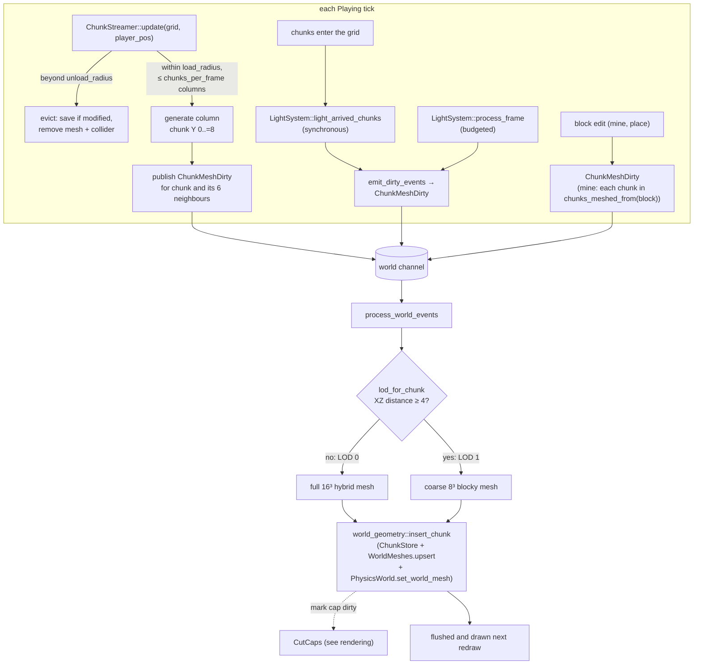

# World streaming

**Source:** `flagstone/src/app/chunk_streamer.rs`, `flagstone/src/app/event_loop/frame_processor.rs`
(`update_chunk_streaming`, `update_light_system`), `event_processor.rs` (`process_world_events`),
`flagstone/src/app/world_geometry.rs`, `flagstone_voxel/src/` (`light_system.rs`, `light_storage.rs`, `streaming.rs`, `light_jobs.rs`, `mesh.rs`).
Voxels live in the flagstone-line `flagstone_voxel` per [ADR-0010](../../_todo/adr/0010-world-geometry-is-a-mesh-contract.md).

## Chunk lifecycle

Neighbours are re-meshed on load because a neighbour meshed before this chunk existed
has an exposed edge face; it must re-sample to close the seam.

A mined block dirties every chunk whose geometry reads it, not only its own: the padded
density field of a chunk reaches `SAMPLE_REACH` (1) block past its far edge, so a block on a
chunk's negative face, edge or corner also dirties the negative neighbours (1, 2, 4 or 8
chunks). `chunks_meshed_from` in
[`flagstone_voxel/src/mesh/hybrid.rs`](../../flagstone_voxel/src/mesh/hybrid.rs) yields that
set. It covers geometry only: smooth normals of the positive neighbour read a block one
further in, so shading there can stay stale until that chunk is next meshed. Placing a block
keeps its previous dirty set.

## Parameters

From `[world]` in [`config/prefs.ini`](../reference/prefs-format.md):

| Key | Meaning |
|---|---|
| `load_radius` | XZ chunk radius loaded around the player |
| `unload_radius` | XZ radius beyond which chunks are evicted (keep > `load_radius` for hysteresis) |
| `chunks_per_frame` | Max new columns per frame and eviction-save budget; minimum 1 |

Chunks are 16³ voxels; columns span chunk Y 0..=8.

## Invariants

- Streaming works in whole XZ columns.
- Freshly generated, unmodified chunks are not persisted on eviction. Only player edits
  are saved ([ADR-0006](../../_todo/adr/0006-save-format-contract.md) covers the format).
- Eviction saves run synchronously in the frame, bounded by `chunks_per_frame`.
- Chunks that enter the grid (streamed in, preloaded by generation, loaded from a save) are
  lit synchronously by `LightSystem::light_arrived_chunks` before the next tick: sky
  exposure is refreshed, stale block light that spread in before their blocks were known is
  cleared, emitters are seeded, and light is refilled from lit neighbour chunks, so their
  first mesh is built from lit data.
- Sky exposure of edited columns is recomputed once per frame, topmost chunk first.
- Meshes bake light per vertex (`VoxelMesh::push_light`: block light, sky exposure, and the
  blended `light_level`) from the air each surface faces: a blocky face reads the voxel in
  front of it, a smooth vertex the air sample of its edge. A light or sky-exposure change
  on a chunk's outer layer therefore also dirties the loaded chunks that read that voxel:
  the face neighbour across the layer (blocky faces), and, because the smooth mesher reads
  one voxel past each positive face, the chunks below it on every low axis, diagonals
  included (`light_storage::reading_chunk_offsets`). Chunks arriving in the grid are exempt from
  the sky part; their neighbours are re-meshed by the arrival itself.
- `process_world_events` forwards every world event to the light system, then re-meshes each
  dirty chunk once per batch, however many events named it.
- The light system processes edits within a per-frame block budget, prioritised by distance to
  the player; large edits spread over several frames.
- Block edits light through reconciliation, not add/remove deltas. `LightSystem` queues one
  `LightUpdateJob` per position an edit left empty, opaque or emissive
  (`MaterialLighting::is_opaque`); `LightPropagator::update_at` then rewrites the light there
  from the grid as it is when the job runs. Jobs are idempotent and order-independent, so
  the grid must already hold the edit when the event reaches `LightSystem`.

## Related

- New-world generation runs as a background job polled by `GenerationProcessor`
  (`poll_generation`); on completion it publishes `ChunkMeshDirty` for the preloaded
  area and enters `Playing`.
- Chunk meshing runs on the main thread in `process_world_events`; there is no background mesh job queue.
