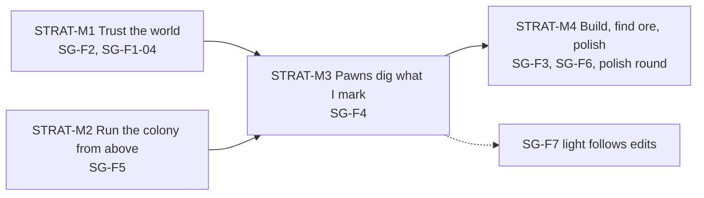

# Flagstone: roadmap

**Status:** living. Owns the order of strategy work: milestones, feature sequence and gates.
Item status is not tracked here; it lives on the [project board](https://github.com/users/WrackedFella/projects/1)
and in the issues. Engine items this page names (the 2.x numbers) are defined in the
[engine roadmap](../engine/roadmap.md); cross-line gates and dependencies are in the [roadmap](../roadmap.md).

Design intent is in the [vision](vision.md) and the [GDD](gdd.md). Update this page when a milestone gate
closes or a feature moves.

## Milestones

Four milestones named for what the player can do. They sit inside ENG-M2 (see the [roadmap](../roadmap.md)). STRAT-M1 and STRAT-M2 may
overlap: their cards touch different code, and the only shared surface is the load path.

| Milestone | Intent | Gate | Features |
|---|---|---|---|
| **STRAT-M1 Trust the world** | A world loads where I left it, mining never tears it, and what I mine tells me so. Fix this before building on it. | SG-F2 exit criteria hold; SG-F1-04 shipped | [SG-F2](https://github.com/WrackedFella/moho/issues/308), SG-F1-04 |
| **STRAT-M2 Run the colony from above** | Strategy mode is a place to be: pan, zoom, select a pawn, step into it and back. | SG-F5 exit criteria hold | [SG-F5](https://github.com/WrackedFella/moho/issues/309) |
| **STRAT-M3 Pawns dig what I mark** | The colony does something without me at the controls; the first job loop that later job types reuse. | SG-F4 exit criteria hold, including marks surviving save and load | [SG-F4](https://github.com/WrackedFella/moho/issues/310) |
| **STRAT-M4 Build, find ore, polish** | The loop closes (mine, build, progress) and the game stops feeling like a prototype. | SG-F1 exit criteria hold: possessed pawns mine and pick up as well as commanded ones. SG-F3 and SG-F6 are not ENG-M2 gate items | [SG-F3](https://github.com/WrackedFella/moho/issues/312), SG-F6, rest of SG-F1, polish round |

Order inside STRAT-M1: spawn on solid ground and survive quit/crash first (in parallel), then no see-through gaps,
with the pickup popup any time. Inside STRAT-M2: camera and possess-and-return in parallel, then click-select.
SG-F4's card-writing pass starts during STRAT-M2 so STRAT-M3 does not stall behind it.

Only the open milestone is carded. SG-F3 and later hold intent and exit criteria until the roadmap reaches them.

## Features

Feature order, with the engine items each needs. SG-F1, SG-F2, SG-F4 and SG-F5 are ENG-M2 gate items; SG-F3 and SG-F6 are not.

| # | Feature | Engine items it needs | Notes |
|---|---|---|---|
| S.1 | [SG-F1](https://github.com/WrackedFella/moho/issues/311) possessing a pawn feels right | 2.1 for feel | — |
| S.2 | [SG-F2](https://github.com/WrackedFella/moho/issues/308) a saved world comes back as I left it: [SG-F2-01](https://github.com/WrackedFella/moho/issues/341), [SG-F2-03](https://github.com/WrackedFella/moho/issues/343), [SG-F2-02](https://github.com/WrackedFella/moho/issues/342) | none | ENG-F10-03 is done, so these no longer race the voxel move; its load-path card covers the #264 gap (scene load skips releasing held keys) |
| S.3 | [SG-F5](https://github.com/WrackedFella/moho/issues/309) run the colony from above, step into a pawn | 2.6, 2.7 (both done) | block and pawn picking are strategy-line; its pan, zoom and possess cards can run alongside S.2 |
| S.4 | [SG-F4](https://github.com/WrackedFella/moho/issues/310) pawns dig what I mark | 2.8 (2.5.1, 2.7 done; 2.9, 2.10 delivered, adopt after the skeleton) | first new persisted type; #303 voxel routing is its card. Before SG-F3 |
| S.4.1 | [SG-F7](https://github.com/WrackedFella/moho/issues/470) light follows what I dig and build: [SG-F7-01](https://github.com/WrackedFella/moho/issues/471) → [SG-F7-02](https://github.com/WrackedFella/moho/issues/472); [SG-F7-03](https://github.com/WrackedFella/moho/issues/473) after #467; [SG-F7-04](https://github.com/WrackedFella/moho/issues/474) (first emissive block) after #473 and [ENG-F24-05](https://github.com/WrackedFella/moho/issues/469); SG-F7-05 with ENG-F29-01; [SG-F7-06](https://github.com/WrackedFella/moho/issues/482) (smooth AO) after SG-F7-05 | ENG-F24-05 (#469) for SG-F7-04; 2.17 ENG-F29-01 for SG-F7-05 | ENG-M2; dug shafts and caves need correct sky light for S.4 |
| S.5 | [SG-F3](https://github.com/WrackedFella/moho/issues/312) buildings and construction (not a gate item) | 2.7 (placement preview) | after SG-F4 |
| S.6 | SG-F6 new worlds look intentional ([draft](../../_todo/flagstone/SG-F6-world-generation/_feature.md), not filed; not a gate item) | none | waits for the user to rank the world-generation problems |

## Open dependencies

- **Navigation over changing terrain** ([#303](https://github.com/WrackedFella/moho/issues/303)) is strategy-line
  work inside SG-F4 and its biggest unknown. It decides whether SG-F4 is the first consumer of an entity-component
  system ([ADR-0004](../../_todo/adr/0004-entity-storage-without-a-general-ecs.md)).
- **World generation ranking.** SG-F6 has no exit criteria until Justin ranks the world-generation problems
  (see the [GDD open questions](gdd.md#open-questions)).
- **Possession feel** (rest of SG-F1) is required for ENG-M2. It gets cards after the STRAT-M2 playtest, not before, and the playtest covers mining while possessed as well as mining by command.

## Out of scope for now

| Idea | Why it waits | Revisit when |
|---|---|---|
| Strategy water | Needs voxel water in strategy terrain first | Justin schedules it |
| Shared pathfinding between strategy routes and the engine's static-level navigation | Neither exists yet | Both exist |
| Automation, progression, needs, combat, other worlds | No named consumer | Their features are proposed ([GDD, deferred ideas](gdd.md#8-deferred-ideas)) |

## Order rules

- Strategy mode is the primary game; first person is possession of one pawn.
- Order is SG-F2, SG-F5, SG-F4, SG-F3 (pawns before buildings). SG-F1 can run any time; SG-F6 once the world-generation problems are ranked.
- Gameplay UI and sound ride inside each feature.
- [SG-F2-03](https://github.com/WrackedFella/moho/issues/343) is reproduce-first and does not wait on the save-format migration.
- [SG-F7](https://github.com/WrackedFella/moho/issues/470) (light follows edits) is part of ENG-M2; the first emissive block (glowing crystal, solid-colour emission) lands with it.

## Where things live

- Feature and card text, status and specs: the GitHub issues and the board.
- Draft features not yet filed: [`_todo/flagstone/`](../../_todo/flagstone/).
- Planning rules (IDs, card lifecycle): [`_todo/_STANDARDS.md`](../../_todo/_STANDARDS.md).
