# World generation research: believable terrain, caves, ore seams, an overworld

**Status:** research, 2026-10-26, for [SG-F6](../../_todo/flagstone/SG-F6-world-generation/_feature.md) (draft).
Direction set by Justin on 2026-10-26: smooth, believable terrain with caves; a large overworld the
player picks a slice from; history and factions as a hook only. This page compares approaches and
recommends the easiest path. The feature draft holds the scope; this page holds the why.

Vocabulary used below: a **block** is one voxel of the editable grid (chunks are 16³ blocks). A
**slice** is the playable area the player picks. The **overworld** is the large low-fidelity map the
slice is cut from. A **tile** is one cell of the overworld.

## 1 What exists today

- Terrain is a binary grid: a block is air or one material, with an optional resource id. The surface
  comes from 2D noise per column plus a per-biome shape; caves are a disabled hook; ore is a 10%
  per-block hash below the top layers (salt-and-pepper iron); crystal is a rarer hash.
- Meshing is already hybrid: marching cubes for terrain, cubes for placed blocks (material id ≥ 100).
  The marching-cubes field is 0/1, so every vertex sits at an edge midpoint. That is why slopes read
  as 45° facets and terraces: the mesher interpolates, but the data has nothing to interpolate.
- Mining removes one block through the rendered isosurface; the yield is one unit of the block's
  resource id. Physics collides with the world mesh, so collision already follows whatever the mesher
  draws ([ADR-0010](../../_todo/adr/0010-world-geometry-is-a-mesh-contract.md),
  [ADR-0027](../../_todo/adr/0027-characters-slide-on-our-own-collide-and-slide.md)).
- Streaming generates whole XZ columns on demand from `(seed, column)`; the world is a square of
  64 to 256 blocks centred on the origin; nothing outside it exists.

So the smooth look is half built. The gaps are the data (no partial density), the large-scale shape
(one noise layer, no water, no drainage), caves (none), and ore (no structure).

## 2 Terrain representation

The question is where "smooth" comes from. Four options, in rising order of change:

| | Representation | What the player sees | Mining | Cost to adopt |
|---|---|---|---|---|
| A | Binary blocks, cube mesh | Minecraft | Whole block | None; rejected by the goal |
| B | Binary blocks, marching cubes on 0/1 (today) | 45° facets, terraces on gentle slopes | Whole block | None; the known "smoothing needs work" |
| C | Binary blocks, mesher smooths the field (blur or vertex relaxation) | Rounded steps; gentle slopes become wavy ramps; thin walls soften | Whole block, a rounded bite | Mesher only |
| D | **Per-block density (0..1) plus material**, marching cubes at 0.5 | The generator's continuous surface, exactly; caves with smooth walls | Whole block today (density → 0); gradual wear later (density −= work) | Storage, chunk file version, generator, the destruction step |

### Why D

- **It is the only option where the surface is the generator's surface.** A, B and C all quantise the
  terrain to block boundaries first and try to recover the shape afterwards. C can only blur the
  staircase; on a slope of one block per eight it produces a ramp at every step and a flat in between.
  D stores the fractional part, and the existing mesher interpolates it with no change.
- **It is the cheapest route to the vision's "mining wears a block away gradually".** The vision
  promises sub-grid deformation (a block becomes a grid of sub-blocks). Per-block density gives the
  same observable behaviour, a block that erodes under repeated work, with no sub-grid: one byte per
  block instead of 8 or 64 sub-blocks, and no second grid to mesh, light, save or path over. Justin
  (2026-10-26) dropped sub-grids as a requirement; D is what replaces them. This is a vision-doc
  edit (see §9).
- **Everything binary stays binary.** Light, sky exposure, navigation, raycast stepping and the
  coarse LOD mesh ask "is this block solid"; the answer becomes `density ≥ 0.5`. Placed blocks
  (material ≥ 100) carry density 1 and keep the cube path. The hybrid plan, the cut caps for the
  underground view and the contact-AO ring do not change.
- **The mesher already does the hard part.** Marching cubes takes an `f32` field and places vertices
  by interpolation; today it is fed 0/1. Feeding it stored density is the whole rendering change.
- **Collision and aiming follow for free.** Physics uses the world mesh and mining aims at the
  isosurface already, so the smooth surface is also the surface pawns stand on and hit.

Costs, for the Tech Lead: one byte per block in chunk storage (4 KiB per chunk on top of the 8 KiB
palette indices), a chunk file version bump under
[ADR-0016](../../_todo/adr/0016-game-lines-own-their-save-kinds.md) (pre-v1 worlds regenerate rather
than migrate, unless SG-F2's contract says otherwise), and the generator writing density instead of
a boolean. The destruction step inside `Pawn::mine` sets density to zero for the hit block, so the
mining contract (`Pawn::mine` and `ResourceYield { resource_id, amount }`) is untouched.

### Rejected

- **Dual contouring / sharp-feature SDF meshing.** Reproduces sharp edges, which matter for man-made
  geometry; ours is blocky by design and already meshed as cubes. Needs Hermite data (normals per
  edge crossing) stored or recomputed, and a QEF solve per cell. More storage and code for a feature
  the game does not need.
- **Surface nets instead of marching cubes.** Equivalent output quality on density data, fewer
  triangles, but marching cubes exists, is tested, and is what the cut caps and seams are built on.
  Not worth a rewrite.
- **Transvoxel for LOD seams.** LOD 1 is a coarse cube mesh at distance; the seam is tolerable from
  the strategy camera. Revisit only if the slice grows past what the current radius hides.
- **Smoothing in the mesher (C) as the destination.** Keep it as the fallback if the Tech Lead sizes
  D above the feature's budget: it is a one-module change and still removes the facets. It does not
  advance gradual mining and it softens 1-block floors and walls, so caves and mined shafts would
  need a guard that keeps the sign of every sample.

## 3 Overworld generation

Goal: a map that reads like a globe or a projection, with oceans, seas, lakes, rivers, mountains and
biomes, cheap enough to generate at "new world" time, and the data the slice is derived from.

| | Approach | Rivers and lakes | Slice consistency | History hook | Cost |
|---|---|---|---|---|---|
| 1 | Stacked noise per column (Minecraft 1.18 style: continentalness, erosion, ridges → splines; temperature × humidity → biome) | Fake: rivers are noise ridges that climb hills; lakes are local dips | Perfect: the slice samples the same functions | None: no global knowledge | Low |
| 2 | **Global pass on a coarse grid** (Dwarf Fortress style): heightmap → depression fill → flow accumulation → rivers that flow downhill; temperature by latitude and elevation; moisture by wind and rain shadow; biome by Whittaker lookup | Real: every river reaches a lake or the sea | Needs a rule: the slice reads the tile record, never its own global state | The tile record is the hook | Low to medium (a 256² to 512² grid runs in well under a second) |
| 3 | Plate tectonics, long erosion simulation, climate model | Real, prettier mountains | As 2 | As 2 | High; sub-second budgets become minutes |

### Recommendation: 2, stored with the world

The overworld is generated once per world from the seed, kept small (a few bytes per tile), saved in
the world file, and is the **only** source of large-scale shape. A slice is a pure function of
`(seed, overworld, absolute tile coordinates)`, computed chunk by chunk exactly as streaming does
today. That rule buys three things:

- **The map is true.** What the player picks on the map is what they get: that biome, that river,
  that coast.
- **Neighbouring slices agree at their edge.** Expansion into an adjacent tile later is a matter of
  generating it; no stitching. This is the one design constraint the first increment must respect
  even though expansion is deferred: no slice-local randomness, no slice-centred coordinates.
- **History has somewhere to live.** Dwarf Fortress runs history as a pass over the finished
  geography, writing to the same tile records (owner, site, ruin). Keeping one extensible tile record
  that the slice generator reads is the entire hook. Nothing else is built now.

Pipeline, coarse to fine:

```mermaid
flowchart LR
    S["seed"] --> H["heightmap<br/>(noise, continent mask)"]
    H --> F["fill depressions<br/>(priority flood)"]
    F --> R["flow accumulation<br/>→ rivers, lakes, sea level"]
    R --> C["climate: latitude, elevation,<br/>wind + rain shadow"]
    C --> B["biome per tile<br/>(Whittaker lookup)"]
    B --> G["geology: mineral richness<br/>per resource per tile"]
    G --> T[("tile records<br/>saved in the world file")]
    T --> P["player picks tiles"]
    P --> SL["slice: chunk-by-chunk<br/>f(seed, tiles, coords)"]
```

Techniques, each standard and documented:

- **Heightmap:** multi-octave noise shaped by a continent mask (radial or low-frequency noise) so
  the map has coasts, not one endless landmass. Optional one pass of thermal erosion for softer
  ridges; skip hydraulic erosion in the first increment (it is the expensive, tunable part).
- **Depression filling and drainage:** priority-flood (Barnes et al. 2014) fills every pit so water
  has a way out, then D8 flow accumulation gives discharge per tile. Tiles above a threshold are
  rivers; pits that filled are lakes; below sea level is sea. This is the step that makes rivers
  believable and it is the one stacked noise cannot do.
- **Climate and biomes:** temperature from latitude and elevation, moisture from a prevailing wind
  sweep with rain shadow behind ridges, biome from a (temperature, moisture) table. Red Blob's
  terrain-from-noise and mapgen4 pages cover the whole chain with working code.
- **Geology:** per resource, a low-frequency richness field biased by elevation and biome (iron and
  copper in uplands, coal in lowland basins, crystal deep anywhere). The tile keeps a richness per
  resource. This is also what "scan a slice before selecting it" reads later; it costs nothing now.

Sizes are tunables, not decisions. A reasonable first set: tile = 64 blocks, overworld 256 × 256 tiles
(16 km a side), slice = 4 × 4 tiles (256 blocks, today's largest world). The decision is the
hierarchy: **tile → slice → chunk**, with the tile as the unit of selection and later expansion.
RimWorld's "choose a map size" is the same choice expressed as a tile count, so both of Justin's
alternatives are the one mechanism.

Sub-tile detail is the slice generator's job: the tile gives the low-frequency controls (height,
biome, river discharge and direction, water level, richness); the slice adds high-frequency relief,
the river channel as a polyline through tile centres with width from discharge, cave and ore
fields. Rivers therefore run between tile centres and look like rivers, not like 64-block-wide
corridors.

## 4 Caves

| | Carver | Chunk-local and deterministic | Look | Cost |
|---|---|---|---|---|
| a | 3D noise threshold ("cheese"): `density −= cavern_noise` where it exceeds a bar | Yes | Caverns and pockets | Low |
| b | Two 3D noises both near zero ("spaghetti", Minecraft 1.18) | Yes | Winding tunnels | Low |
| c | Worm agents (seeded random walks carving tubes) | Only with a per-region pass every chunk queries | Tunnels with intent, long and connected | Medium |
| d | Cellular automata | No | Organic caverns | Needs a whole-slice pass; conflicts with streaming |

Recommendation: **a + b**, both as terms in the same density function the terrain uses, with a depth
gradient (none in the top layers except where a tunnel reaches the surface, more with depth) and the
cave terms suppressed under the start area. Two cheap noise terms give two cave kinds; the surface
entrances come for free wherever the cave field crosses the terrain surface. Under option D the walls
are smooth; under B or C they are blocky. Caves dark under a roof and lit at the mouth are already
SG-F7's. Worm agents (c) are the later upgrade if noise caves read as random: they can be made
chunk-local by seeding worms per tile and letting each chunk carve the worms of the tiles within
reach, which is how Minecraft's older carvers worked.

## 5 Ore: seams versus whole blocks

Two ideas were tangled: the **unit of yield** (one whole block of iron) and the **spatial
distribution** (scattered blocks or seams). They are independent. Keep the first, change the second.

- **Unit of yield stays the block.** One material plus an optional resource id per block, one unit per
  block mined. `Pawn::mine` and `ResourceYield` do not change; under option D a seam that cuts a block
  partially is still one block of ore.
- **Distribution becomes seams.** Ore is placed where a 3D ridged noise is near zero inside the
  resource's depth band (a vein noise), scaled by the tile's richness for that resource. Result:
  elongated contiguous bodies of tens of blocks, a few blocks thick, at a density the tile sets. One
  noise sample per solid block in the band; the same technique Minecraft adopted for its large copper
  and iron veins. Salt-and-pepper placement ends.
- **Findable means visible.** Seams that reach a cave wall, a cliff face or a river bank show on the
  surface mesh (face material per vertex already exists), so the player has somewhere to start. The
  finding that surface scraping yields nothing stays true for the open ground and stops being the
  whole story.
- **Resources stay setting-neutral.** The feature adds at most one resource beyond iron and crystal
  (copper is the natural second), as ids with display names, so the swappable setting stays swappable.

## 6 Water, trees and the start area

- **Water** is where the strategy roadmap says "needs voxel water first". The believable minimum is
  **still water**: a water material filling tiles below the body's water level, drawn as a flat
  surface, impassable to pawns (RimWorld's deep water). No flow, no swimming, no swimming physics.
  Whether the surface needs translucency from the engine is a Tech Lead question; an opaque
  water-coloured surface is acceptable for this feature.
- **Trees** as voxel structures (trunk and canopy as placed-block materials), scattered by a jittered
  grid with density from the biome. They mesh through the existing cube path, mine like any block and
  yield wood if a wood resource id is wanted. glTF models would be prettier and would need a new
  entity kind, harvesting rules and collision; not for this feature.
- **The start area is found, not flattened.** Search the slice for the flattest dry patch of a set
  size with no cave under it and a seam within reach; suppress cave terms under it. Flattening a
  believable slope back to a plateau is what makes a start area look generated. SG-F2's "no pawn
  spawns inside terrain" still holds.

## 7 Mining under density, and what stays neutral

| Step | Today | With density, this feature | Later (gradual wear) |
|---|---|---|---|
| Aim | Ray to the isosurface | Same | Same |
| Destroy | Remove the block | Set its density to 0 | Subtract work from density; the block goes when it crosses the threshold |
| Yield | One unit of the block's resource | Same | Same, on crossing; or proportional, still `ResourceYield` |
| Placing a block | Density 1, cube material | Same | Same |

Only the destroy row changes, and only inside the destruction step the vision already names as the
one place allowed to know the granularity.

## 8 Recommended path, in order

1. **Density blocks** (§2 D): storage, generator writes the continuous surface, mining sets zero.
   Visible result on day one: no facets, no terraces, same worlds otherwise.
2. **Caves** (§4 a + b) and **ore seams** (§5) as terms in the same density and material functions.
   Chunk-local, no new persistence.
3. **Overworld** (§3) and **slice selection**: the generation step produces the tile records and the
   new-world screen shows the map; the slice generator reads the tile controls. The current square
   world becomes "a 4 × 4 tile slice at the picked tile".
4. **Still water and trees** (§6), last, because they are the first new materials the mesher, light
   and navigation meet.

Each step is observable on its own and none depends on a later one, so the feature can stop after
any of them and still have shipped something.

## 9 Consequences for other documents

- **Vision:** "Mining will become sub-grid deformation" becomes "Mining will become gradual: a block
  wears away by losing density; whole-block removal is the degenerate case." Same promise, cheaper
  mechanism. Needs Justin's OK (a plain vision edit).
- **GDD open question Q1** (what looks wrong) is answered by Justin's direction: facets and terraces,
  no caves, no large-scale structure or water, scattered ore.
- **ADR candidates** for the Tech Lead: terrain is density plus material (supersedes the binary
  assumption in the voxel crate's contract); the overworld is stored data and the slice is a pure
  function of it.
- **Engine:** no engine request identified. Seeded RNG for the overworld passes is
  [ENG-F6-01](https://github.com/WrackedFella/moho/issues/335). Possible requests if the Tech Lead
  finds them: a translucent water material; drawing the overworld as an image in the UI shell.

## References

- Marching cubes: Bourke, [Polygonising a scalar field](https://paulbourke.net/geometry/polygonise/).
- Surface nets and smooth voxels: Lysenko, [Smooth voxel terrain](https://0fps.net/2012/07/12/smooth-voxel-terrain-part-2/).
- Dual contouring: Boris the Brave, [Dual contouring tutorial](https://www.boristhebrave.com/2018/04/15/dual-contouring-tutorial/).
- LOD seams: Lengyel, [Transvoxel](https://transvoxel.org/).
- Stacked-noise terrain and biomes: Kniberg, [Reinventing Minecraft world generation](https://www.youtube.com/watch?v=ob3VwY4JyzE); [Minecraft wiki, World generation](https://minecraft.wiki/w/World_generation).
- Noise to terrain, climate and biomes: Red Blob Games, [Making maps with noise functions](https://www.redblobgames.com/maps/terrain-from-noise/) and [mapgen4](https://www.redblobgames.com/maps/mapgen4/).
- Rivers from drainage: Barnes, Lehman, Mulla, [Priority-Flood](https://arxiv.org/abs/1511.04463); Patel, [Polygonal map generation](http://www-cs-students.stanford.edu/~amitp/game-programming/polygon-map-generation/).
- Hydraulic erosion (deferred): Lague, [Hydraulic-Erosion](https://github.com/SebLague/Hydraulic-Erosion).
- Overworld, embark and history: [Dwarf Fortress wiki, World generation](https://dwarffortresswiki.org/index.php/World_generation).
