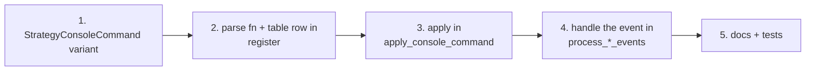

# Adding a console command

Both games register commands on the engine console, `moho_ui_shell::Console`. Build a
`moho_ui_shell::CommandSpec` (name, usage, help and a plain `fn` parse returning the game's
command and a reply, or an error reply; an empty reply prints nothing, for a result only the game
knows once it acts, which it prints with `Console::print` where it drains `take_commands`) and
call `Console::register`; a name the engine (`help`, `clear`, `quit`, `r_debug_view`,
`r_shadow_quality`, `r_ssao_quality`, `audio_cue`) or the game already has is refused. The game
drains `Console::take_commands` and applies them in its tick
([ADR-0017](../../_todo/adr/0017-ui-shell-and-debug-values-are-engine-seams.md)).

Searchlight does this in its own `console_commands.rs`. The steps below are strategy's.

**Source:** `flagstone_ui/src/console_commands.rs`, `flagstone/src/app/console.rs`.
Background: [console](../architecture/console.md).



1. **Add a variant** to `StrategyConsoleCommand` in `console_commands.rs`.
2. **Parse it.** Add a `parse_<name>(args: &[&str])` fn returning `Ok((command, reply))` or
   `Err(usage)`, and a row in the table in `register`. Validate arguments here and return a
   usage message on bad input; a bad parse queues nothing.
3. **Publish an event.** Add an arm in `apply_console_command` (`flagstone/src/app/console.rs`).
   Reuse an existing event family where it fits (`DebugEvent`, `GraphicsEvent`,
   `UiEvent`); a new engine-wide event type goes in `moho_core::events`, and a
   strategy-only one in the flagstone line ([ADR-0003](../../_todo/adr/0003-core-owns-event-types.md), narrowed by
   [ADR-0010](../../_todo/adr/0010-world-geometry-is-a-mesh-contract.md)).
4. **Handle the event** in the matching drain in `event_processor.rs`. This is where
   `App` is mutated ([events](../architecture/events.md#the-channel-hand-off)).
5. **Document and test.** Put the help text in the table row, add a row to
   [console commands](../reference/console-commands.md), and unit tests for parsing
   (valid, missing arg, out-of-range) next to the existing ones in `console_commands.rs`.

## Example

```rust
// console_commands.rs
pub enum StrategyConsoleCommand { /* … */ Teleport(f32, f32, f32) }
// table row in `register`: ("tp <x> <y> <z>", "Teleport the player", parse_tp)
```

```rust
// flagstone/src/app/console.rs, in apply_console_command
StrategyConsoleCommand::Teleport(x, y, z) => {
    app.event_bus.publish(DebugEvent::TeleportPlayer { position: glam::Vec3::new(*x, *y, *z) });
}
```

`DebugEvent::TeleportPlayer` already exists; add its handler in `handle_debug_event`.
